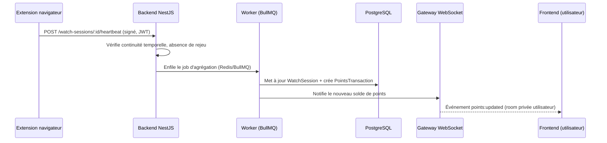
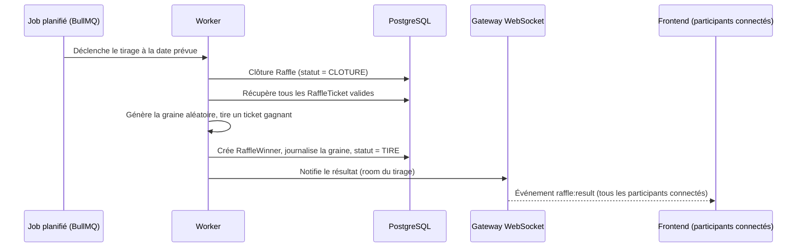
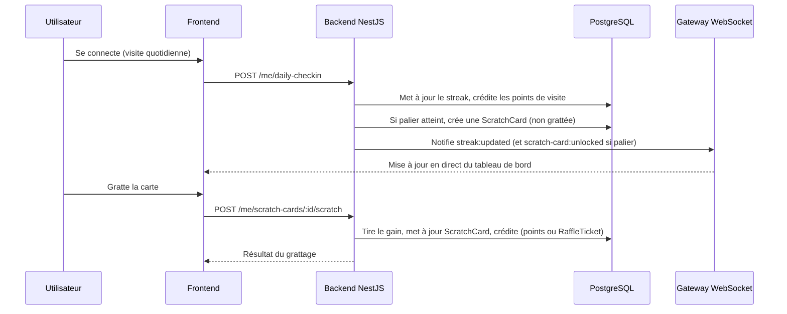

# 02. Architecture technique

## Vue d'ensemble

```text
      ┌────────────────────┐
      │ Extension           │  (Chrome/Firefox, hors Docker)
      │ navigateur          │──────────┐
      └────────────────────┘          │ heartbeats
                                       │ authentifiés
                       ┌──────────────────────┐
                       │   Reverse proxy       │
                       │  Traefik (TLS auto)   │
                       └──────────┬───────────┘
                                  │
              ┌───────────────────┼───────────────────┐
              │                   │                   │
      ┌───────▼───────┐   ┌───────▼───────┐   ┌───────▼───────┐
      │   Frontend     │◀─▶│  Backend API  │   │   Worker      │
      │  Next.js (SSR) │ WS │  NestJS       │   │  BullMQ jobs  │
      │                │   │  + Gateway WS  │   │               │
      └───────┬───────┘   └───────┬───────┘   └───────┬───────┘
              │                   │                   │
              └───────────┬───────┴───────────┬───────┘
                          │                   │
                  ┌───────▼───────┐   ┌───────▼───────┐
                  │  PostgreSQL   │   │     Redis     │
                  └───────────────┘   └───────────────┘
```

Le flux WS est bidirectionnel entre le frontend et le backend (le backend
pousse les mises à jour ; le frontend n'a pas besoin d'émettre d'événements
métier via ce canal). Redis sert aussi d'adaptateur pub/sub pour le
WebSocket si le backend est un jour répliqué sur plusieurs instances (voir
section dédiée plus bas).

L'extension navigateur n'est pas conteneurisée (elle s'exécute dans le
navigateur de l'utilisateur) mais fait partie du même dépôt et du même
pipeline CI que le reste (voir [08-docker-infra.md](08-docker-infra.md)
pour ce que Docker couvre réellement).

## Choix de stack (ADR-001)

| Composant | Choix | Justification |
| --- | --- | --- |
| Frontend | Next.js (React + TypeScript) + TailwindCSS | SSR pour le référencement des pages publiques (tirages, lots), écosystème riche pour un design system custom, TypeScript partagé avec le backend. |
| Backend | NestJS (Node.js + TypeScript) | Structure modulaire, guards/interceptors natifs adaptés aux besoins de l'agent cybersécurité (rate limiting, validation), même langage que le frontend pour limiter le contexte switch entre agents. |
| Base de données | PostgreSQL + Prisma ORM | Transactions fiables nécessaires pour la comptabilité des points et des tickets, migrations versionnées avec Prisma. |
| Cache et files d'attente | Redis + BullMQ | Rate limiting, sessions, et jobs asynchrones (agrégation de watch time, tirage au sort, notifications). |
| Authentification | Email/mot de passe + JWT de session, OAuth2 (Twitch, Google, Facebook) en option | La liaison de compte tiers est un confort optionnel, pas un prérequis : le watch time repose sur l'extension navigateur, pas sur une autorisation demandée aux plateformes (voir section dédiée plus bas). |
| Infra | Docker Compose, reverse proxy Traefik avec TLS Let's Encrypt | Portable sur un VPS auto-géré, pas de dépendance à un cloud managé. |
| CI | GitHub Actions | Lint, typecheck, tests, build des images Docker, obligatoire avant merge sur dev et main. |
| Extension navigateur | WebExtension (Manifest V3) en TypeScript, polyfill `webextension-polyfill` pour la compatibilité Chrome/Firefox | Un seul code source pour les deux navigateurs cibles, TypeScript cohérent avec le reste du projet. **V1.0 : publication Chrome uniquement, Firefox en V1.1** (le polyfill est gardé dès le V1.0 pour ne pas avoir à réécrire le code au moment d'ajouter Firefox). |
| Temps réel | WebSocket via NestJS Gateway (Socket.io) | Pousse au frontend les mises à jour de solde de points, de streak, de cartes à gratter débloquées et de résultats de tirage sans que l'utilisateur ait à recharger la page. Socket.io choisi pour la gestion native des rooms (une par utilisateur, une par tirage) et son adaptateur Redis pour passer à plusieurs instances backend si besoin. |

### Alternatives considérées

- Django/Python au lieu de NestJS : écarté pour garder un langage unique (TypeScript) entre front et back, ce qui simplifie la coordination entre les agents frontend et backend.
- MongoDB au lieu de PostgreSQL : écarté car la comptabilité de points/tickets bénéficie fortement des transactions ACID et de contraintes relationnelles strictes.
- Cloud managé (AWS/GCP) : écarté à ce stade suite au choix du client (VPS auto-géré), mais l'architecture Docker Compose reste portable vers un cloud managé si besoin en V2.

## Extension navigateur : mesure du watch time (décision d'architecture critique)

Aucune plateforme (Twitch, YouTube, Facebook) n'expose d'API publique
donnant le temps de visionnage d'un utilisateur précis sur un stream. Le
cahier des charges client confirme qu'une extension navigateur doit être
développée ; elle devient le mécanisme principal de mesure du watch time,
avec le lecteur embarqué en mécanisme de repli.

### Mécanisme principal : extension navigateur

1. L'utilisateur installe l'extension (Chrome pour le lancement V1.0,
   Firefox ajouté en V1.1) et l'associe à son compte SKUP via un token
   d'appariement généré depuis le
   site (flux similaire à un login OAuth, sans exposer le mot de passe à
   l'extension).
2. L'extension détecte, via les APIs de navigation du navigateur (`tabs`,
   `webNavigation`), quand l'onglet actif correspond à une page de
   visionnage sur twitch.tv, youtube.com ou facebook.com, et si l'onglet
   est réellement au premier plan (pas seulement ouvert en arrière-plan).
3. Tant que ces conditions sont réunies, l'extension envoie des heartbeats
   signés au backend toutes les 30 à 60 secondes, avec l'URL/le domaine
   observé (pas l'historique de navigation complet, uniquement le fait
   d'être sur une page de stream).
4. Le backend valide chaque heartbeat (continuité temporelle, absence de
   rejeu, cohérence avec la session utilisateur) avant de créditer les
   points, via un job Redis/BullMQ qui agrège les heartbeats en session de
   visionnage, exactement comme pour le lecteur embarqué (même pipeline de
   validation, seule la source du heartbeat change).
5. L'extension ne prétend pas exposer une métrique officielle Twitch ou
   YouTube : elle mesure une présence active de l'utilisateur sur une page
   de stream, ce qui reste défendable au regard des conditions
   d'utilisation de ces plateformes (voir aussi
   [05-security.md](05-security.md) pour les limites de confidentialité à
   respecter dans les permissions demandées).

### Mécanisme de repli : lecteur embarqué sur le site

Pour les viewers qui n'installent pas l'extension, un lecteur officiel
embarqué directement sur une page du site (Twitch embed, YouTube IFrame
Player API, Facebook Video Plugin) reste disponible. Le frontend écoute les
événements du lecteur et envoie des heartbeats selon le même principe que
l'extension, mais limité au temps passé sur la page du site elle-même.

### Diagramme de séquence : heartbeat de visionnage



### Points ouverts à clarifier avec le client avant l'implémentation

- Permissions exactes demandées par l'extension (limiter au strict
  nécessaire : hôtes twitch.tv/youtube.com/facebook.com, pas un accès
  large à tout l'historique de navigation).
- Politique des stores (Chrome Web Store, Firefox Add-ons) concernant les
  extensions qui mesurent du temps de présence : disclosure claire dans la
  fiche de l'extension, page de confidentialité dédiée.
- Comportement si l'extension est désinstallée ou désactivée en cours de
  session (pas de perte de points déjà crédités, juste arrêt des futurs
  heartbeats).

Fonctionnalités écartées de la V1 pour cette raison :

- Twitch Extensions officielles (nécessitent l'installation par le
  streamer partenaire, mesurent une présence approximative, à ne pas
  confondre avec notre propre extension navigateur ci-dessus).
- Twitch Drops (réservé aux organisateurs approuvés par Twitch, processus
  de partenariat non accessible à un site tiers indépendant).

## Temps réel (WebSocket)

Certaines informations doivent se mettre à jour instantanément côté
utilisateur sans rechargement de page :

- solde de points après un heartbeat de visionnage validé ou une visite
  quotidienne ;
- progression de streak et déblocage d'une carte à gratter ;
- compte à rebours et statut d'un tirage (ouvert, clôturé, tiré) ;
- annonce du résultat d'un tirage aux participants connectés.

Le backend NestJS expose une Gateway WebSocket (Socket.io). Chaque
utilisateur authentifié rejoint une room privée (son propre canal) à la
connexion, via le même JWT que pour les appels REST (poignée de main
authentifiée, pas de canal anonyme). Les tirages ont aussi une room dédiée
pour diffuser l'ouverture, la clôture et le résultat à tous les
participants connectés en simultané.

Les workers BullMQ (agrégation de watch time, exécution du tirage) publient
sur ces rooms après avoir persisté le changement en base ; le WebSocket est
une notification de ce qui vient d'être écrit, jamais la source de vérité
elle-même (celle-ci reste PostgreSQL). Si la connexion WebSocket d'un
utilisateur est coupée, un rafraîchissement classique via l'API REST reste
toujours possible : le temps réel est un confort, pas une dépendance
bloquante.

Voir [05-security.md](05-security.md) pour l'authentification et le rate
limiting des connexions WebSocket, et
[08-docker-infra.md](08-docker-infra.md) pour la question de la montée en
charge (adaptateur Redis) si plusieurs instances du backend sont un jour
nécessaires.

## Modèle de tirage au sort

Un job planifié (BullMQ) exécute le tirage à date fixe : sélection aléatoire parmi les tickets valides, avec graine aléatoire journalisée pour permettre un audit a posteriori. Le résultat est stocké de façon immuable (table d'historique des tirages) et publié sur le site.

### Diagramme de séquence : exécution du tirage



### Diagramme de séquence : carte à gratter (streak)



## Documents liés

- [03-data-model.md](03-data-model.md) : détail des entités (utilisateurs, comptes liés, sessions de visionnage, points, tickets, tirages, lots)
- [04-api-contract.md](04-api-contract.md) : endpoints et contrats OAuth
- [05-security.md](05-security.md) : menaces et mitigations
- [08-docker-infra.md](08-docker-infra.md) : topologie Docker détaillée
