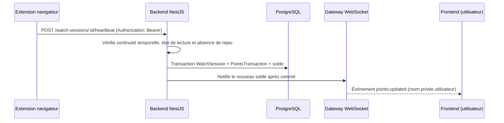
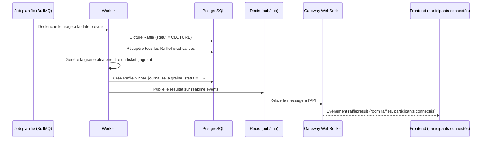
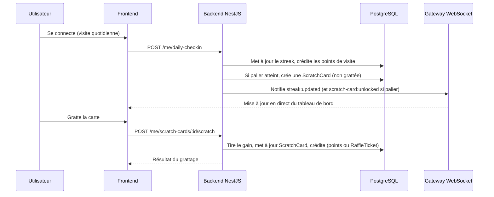

# 02. Architecture technique

## Vue d'ensemble

```text
      ┌────────────────────┐
      │ Extension           │  (Chrome/Firefox, hors Docker)
      │ navigateur          │──────────┐
      └────────────────────┘          │ heartbeats
                                       │ authentifiés
                       ┌──────────────────────┐
                       │   Reverse proxy       │
                       │  Traefik (TLS auto)   │
                       └──────────┬───────────┘
                                  │
              ┌───────────────────┼───────────────────┐
              │                   │                   │
      ┌───────▼───────┐   ┌───────▼───────┐   ┌───────▼───────┐
      │   Frontend     │◀─▶│  Backend API  │   │   Worker      │
      │  Next.js (SSR) │ WS │  NestJS       │   │  BullMQ jobs  │
      │                │   │  + Gateway WS  │   │               │
      └───────┬───────┘   └───────┬───────┘   └───────┬───────┘
              │                   │                   │
              └───────────┬───────┴───────────┬───────┘
                          │                   │
                  ┌───────▼───────┐   ┌───────▼───────┐
                  │  PostgreSQL   │   │     Redis     │
                  └───────────────┘   └───────────────┘
```

Le flux WS est bidirectionnel entre le frontend et le backend (le backend
pousse les mises à jour ; le frontend n'a pas besoin d'émettre d'événements
métier via ce canal). Redis sert aussi d'adaptateur pub/sub pour le
WebSocket si le backend est un jour répliqué sur plusieurs instances (voir
section dédiée plus bas).

L'extension navigateur n'est pas conteneurisée (elle s'exécute dans le
navigateur de l'utilisateur) mais fait partie du même dépôt et du même
pipeline CI que le reste (voir [08-docker-infra.md](08-docker-infra.md)
pour ce que Docker couvre réellement).

## Choix de stack (ADR-001)

| Composant | Choix | Justification |
| --- | --- | --- |
| Frontend | Next.js (React + TypeScript) + TailwindCSS | SSR pour le référencement des pages publiques (tirages, lots), écosystème riche pour un design system custom, TypeScript partagé avec le backend. |
| Backend | NestJS (Node.js + TypeScript) | Structure modulaire, guards/interceptors natifs adaptés aux besoins de l'agent cybersécurité (rate limiting, validation), même langage que le frontend pour limiter le contexte switch entre agents. |
| Base de données | PostgreSQL + Prisma ORM | Transactions fiables nécessaires pour la comptabilité des points et des tickets, migrations versionnées avec Prisma. |
| Cache et files d'attente | Redis + BullMQ | Rate limiting, sessions, et jobs asynchrones (agrégation de watch time, tirage au sort, notifications). |
| Authentification | Email/mot de passe + JWT de session, OAuth2 (Twitch, Google, Facebook) en option | La liaison de compte tiers est un confort optionnel, pas un prérequis : le watch time repose sur l'extension navigateur, pas sur une autorisation demandée aux plateformes (voir section dédiée plus bas). |
| Infra | Docker Compose, reverse proxy Traefik avec TLS Let's Encrypt | Portable sur un VPS auto-géré, pas de dépendance à un cloud managé. |
| CI | GitHub Actions | Lint, typecheck, tests, build des images Docker, obligatoire avant merge sur dev et main. |
| Extension navigateur | WebExtension (Manifest V3) en TypeScript, polyfill `webextension-polyfill` pour la compatibilité Chrome/Firefox/Opera | Un seul code source pour les navigateurs cibles, TypeScript cohérent avec le reste du projet. **V1.0 : publication Chrome uniquement, Firefox et Opera en V1.1** (le polyfill est gardé dès le V1.0 pour limiter les adaptations lors des publications différées). |
| Temps réel | WebSocket via NestJS Gateway (Socket.io) | Pousse au frontend les mises à jour de solde de points, de streak, de cartes à gratter débloquées et de résultats de tirage sans que l'utilisateur ait à recharger la page. Socket.io choisi pour la gestion native des rooms (une par utilisateur, une par tirage) et son adaptateur Redis pour passer à plusieurs instances backend si besoin. |

### Alternatives considérées

- Django/Python au lieu de NestJS : écarté pour garder un langage unique (TypeScript) entre front et back, ce qui simplifie la coordination entre les agents frontend et backend.
- MongoDB au lieu de PostgreSQL : écarté car la comptabilité de points/tickets bénéficie fortement des transactions ACID et de contraintes relationnelles strictes.
- Cloud managé (AWS/GCP) : écarté à ce stade suite au choix du client (VPS auto-géré), mais l'architecture Docker Compose reste portable vers un cloud managé si besoin en V2.

## Extension navigateur : mesure du watch time (décision d'architecture critique)

Aucune plateforme (Twitch, YouTube, Facebook) n'expose d'API publique
donnant le temps de visionnage d'un utilisateur précis sur un stream. Le
cahier des charges client confirme qu'une extension navigateur doit être
développée ; elle devient le mécanisme principal de mesure du watch time,
sans lecteur embarqué : l'extension navigateur est l'unique mécanisme de suivi.

### Mécanisme principal : extension navigateur

1. L'utilisateur installe l'extension (Chrome pour le lancement V1.0,
   Firefox et Opera ajoutés en V1.1) et l'associe à son compte SKUP via un token
   d'appariement généré depuis le
   site (flux similaire à un login OAuth, sans exposer le mot de passe à
   l'extension).
2. L'extension détecte, depuis un script de contenu injecté sur les pages
   de twitch.tv, youtube.com et facebook.com, qu'une page de visionnage
   est ouverte et que son onglet est réellement au premier plan (pas
   seulement ouvert en arrière-plan). L'implémentation n'utilise
   finalement ni `tabs` ni `webNavigation`, envisagés au moment de la
   conception : observer la page depuis l'intérieur suffit et évite de
   demander des permissions qui donneraient accès à l'historique de
   navigation (voir « Implémentation de l'extension » plus bas).
3. Tant que ces conditions sont réunies, l'extension envoie des heartbeats
   signés au backend toutes les 30 à 60 secondes, avec l'URL/le domaine
   observé (pas l'historique de navigation complet, uniquement le fait
   d'être sur une page de stream).
4. Le backend valide chaque heartbeat (continuité temporelle, absence de
   rejeu, cohérence avec la session utilisateur) avant de créditer les
   points, via un job Redis/BullMQ qui agrège les heartbeats en session de
   visionnage, exactement comme pour le lecteur embarqué (même pipeline de
   validation, seule la source du heartbeat change).
5. L'extension ne prétend pas exposer une métrique officielle Twitch ou
   YouTube : elle mesure une présence active de l'utilisateur sur une page
   de stream, ce qui reste défendable au regard des conditions
   d'utilisation de ces plateformes (voir aussi
   [05-security.md](05-security.md) pour les limites de confidentialité à
   respecter dans les permissions demandées).

### Implémentation de l'extension (V1.0)

Le code vit dans `extension/`, à la racine du dépôt, avec son propre
`package.json` : ce n'est ni une application Next.js ni un service
conteneurisé, et son outillage (esbuild, pas de framework) n'a rien à
voir avec celui du frontend. Elle a en revanche son propre job dans la
CI, au même titre que le frontend et le backend
([07-ci-cd.md](07-ci-cd.md)).

```text
extension/src/manifeste.ts    Manifeste MV3 construit au build
extension/src/commun/         Client HTTP porteur du jeton, endpoints, stockage
extension/src/contenu/        Script de contenu : détection de lecture
extension/src/arriere-plan/   Service worker : orchestration des sessions
extension/src/popup/          Popup d'association du compte
```

Décisions structurantes :

- **Permissions minimales** : `storage` et `alarms`, plus une unique
  permission d'hôte pour l'origine de l'API. Les trois plateformes ne
  figurent que dans `content_scripts.matches`, ce qui suffit à injecter
  le script sans accorder l'accès à leurs cookies ni le droit d'émettre
  des requêtes en leur nom. Aucune permission ne donne accès à
  l'historique de navigation.
- **Manifeste généré au build** : la permission d'hôte doit être écrite
  en clair dans le paquet publié et ne peut pas être calculée à
  l'exécution. La générer depuis l'URL d'API du build garantit qu'elle
  correspond exactement à l'origine appelée.
- **Répartition des rôles** : le script de contenu observe et ne connaît
  ni l'API ni le jeton ; le service worker détient le jeton et parle à
  l'API. Un script exécuté dans une page tierce n'a ainsi aucun
  credential à portée de main.
- **État en `storage.session`** : le service worker MV3 est arrêté dès
  qu'il est inactif, aucune variable en mémoire ne survit. L'état de
  suivi est donc persisté, mais dans un stockage non écrit sur disque et
  vidé à la fermeture du navigateur. Seul le jeton d'appariement va dans
  `storage.local`, parce qu'il doit survivre aux redémarrages.
- **Cadence irrégulière aux deux étages** : le script de contenu pousse
  son état toutes les 10 à 16 secondes (ce qui réveille le service
  worker), qui envoie un heartbeat une fois écoulé un délai de 40 à
  50 secondes. Les deux tirages sont nécessaires : le heartbeat part au
  premier signal reçu après l'échéance du délai, donc une période de
  signal fixe ramènerait tous les heartbeats sur la même grille et le
  serveur mesurerait un intervalle constant malgré la gigue du délai.
  Or le backend invalide une session dont cinq intervalles consécutifs
  sont rigoureusement identiques. L'écart maximal possible (66 secondes)
  reste sous le plafond de plausibilité de 90 secondes.

Le jeton d'appariement est accepté par les routes protégées
`POST /watch-sessions`, `POST /watch-sessions/:id/heartbeat` et
`POST /watch-sessions/:id/close`. La garde de credential distingue la
session web portée par le cookie du jeton opaque présenté par l'extension
dans l'en-tête `Authorization: Bearer`. La source de la session est dérivée
côté serveur depuis ce credential et ne provient jamais du payload client.
Les sessions ouvertes depuis une extension appariée active peuvent donc
créditer des points, tandis que celles du lecteur embarqué restent suivies
sans crédit. La révocation d'un appareil est prise en compte immédiatement
par la garde d'extension (voir [05-security.md](05-security.md), section
« Appariement de l'extension navigateur »).

### Mécanisme de repli : lecteur embarqué sur le site

Pour les viewers qui n'installent pas l'extension, un lecteur officiel
embarqué directement sur une page du site (Twitch embed, YouTube IFrame
Player API, Facebook Video Plugin) reste disponible. Le frontend écoute les
événements du lecteur et envoie des heartbeats selon le même principe que
l'extension, mais limité au temps passé sur la page du site elle-même.

Implémentation V1.0 : la page `/streams` consomme le catalogue public puis
monte le lecteur officiel YouTube de la chaîne choisie. L'intégration utilise
le protocole `postMessage` de l'iframe, avec contrôle simultané de l'origine
YouTube et de la fenêtre émettrice. Aucun script tiers ne s'exécute dans
l'origine du site. Twitch et Facebook conservent pour l'instant un état
d'attente ; leur ajout réutilisera la même orchestration de session. Les
heartbeats sont suspendus dès que l'onglet n'est plus visible, même si le
lecteur continue techniquement sa lecture en arrière-plan.

Ces heartbeats alimentent la session mais ne créditent pas encore de points.
Le navigateur étant contrôlé par l'utilisateur, `postMessage` ne fournit pas
une preuve serveur suffisante. L'activation du crédit attend une attestation
de plateforme vérifiable côté backend.

### Diagramme de séquence : heartbeat de visionnage



### Points ouverts à clarifier avec le client avant l'implémentation

- ~~Permissions exactes demandées par l'extension~~ : tranché à
  l'implémentation, voir « Implémentation de l'extension » ci-dessus
  (`storage`, `alarms`, une permission d'hôte pour l'API, et les trois
  plateformes uniquement en motifs de script de contenu).
- Politique des stores (Chrome Web Store, Firefox Add-ons) concernant les
  extensions qui mesurent du temps de présence : disclosure claire dans la
  fiche de l'extension, page de confidentialité dédiée.
- Comportement si l'extension est désinstallée ou désactivée en cours de
  session (pas de perte de points déjà crédités, juste arrêt des futurs
  heartbeats).

Fonctionnalités écartées de la V1 pour cette raison :

- Twitch Extensions officielles (nécessitent l'installation par le
  streamer partenaire, mesurent une présence approximative, à ne pas
  confondre avec notre propre extension navigateur ci-dessus).
- Twitch Drops (réservé aux organisateurs approuvés par Twitch, processus
  de partenariat non accessible à un site tiers indépendant).

## Temps réel (WebSocket)

Certaines informations doivent se mettre à jour instantanément côté
utilisateur sans rechargement de page :

- solde de points après un heartbeat de visionnage validé ou une visite
  quotidienne ;
- progression de streak et déblocage d'une carte à gratter ;
- compte à rebours et statut d'un tirage (ouvert, clôturé, tiré) ;
- annonce du résultat d'un tirage aux participants connectés.

Le backend NestJS expose une Gateway WebSocket (Socket.io). Chaque
utilisateur authentifié rejoint une room privée (son propre canal) à la
connexion, via le même JWT que pour les appels REST (poignée de main
authentifiée, pas de canal anonyme). Les tirages ont aussi une room dédiée
pour diffuser l'ouverture, la clôture et le résultat à tous les
participants connectés en simultané.

Les workers BullMQ (agrégation de watch time, exécution du tirage) publient
sur ces rooms après avoir persisté le changement en base ; le WebSocket est
une notification de ce qui vient d'être écrit, jamais la source de vérité
elle-même (celle-ci reste PostgreSQL). Si la connexion WebSocket d'un
utilisateur est coupée, un rafraîchissement classique via l'API REST reste
toujours possible : le temps réel est un confort, pas une dépendance
bloquante.

Voir [05-security.md](05-security.md) pour l'authentification et le rate
limiting des connexions WebSocket, et
[08-docker-infra.md](08-docker-infra.md) pour la question de la montée en
charge (adaptateur Redis) si plusieurs instances du backend sont un jour
nécessaires.

### Implémentation de la Gateway

- **Poignée de main** : le JWT est lu dans le champ `auth.token` de la
  poignée de main Socket.io, à défaut dans l'en-tête `Authorization:
  Bearer`. Jamais dans la query string, qui finit dans les journaux
  d'accès du reverse proxy. Token absent, expiré, mal signé ou sans
  `sub` exploitable : la socket est déconnectée immédiatement, il
  n'existe aucun canal anonyme.
- **Room privée** : `user:<userId>`, où `userId` est le `sub` du JWT
  vérifié. Le client ne transmet jamais l'identifiant de la room qu'il
  rejoint, ce qui exclut par construction l'accès au canal d'un autre
  utilisateur.
- **Room des tirages** : choix V1.0, une room commune `raffles` que tout
  utilisateur authentifié rejoint automatiquement, le `raffleId` étant
  porté par le payload de l'événement. Les données diffusées sont celles
  déjà exposées publiquement par `GET /raffles/:id/result` (jamais
  d'identifiant utilisateur), il n'y a donc rien à cloisonner. Une room
  par tirage avec abonnement explicite reste possible plus tard sans
  changer les payloads.
- **Connexions simultanées** : plafonnées par utilisateur (10), au-delà
  la connexion est refusée (menace 4 de [05-security.md](05-security.md)).
- **Origines** : la poignée de main n'accepte que les origines listées
  dans `CORS_ORIGINS`. Variable vide, aucune origine tierce n'est admise.
- **Publication depuis le worker** : le worker BullMQ tourne dans un
  processus distinct et n'héberge pas de serveur Socket.io. Il publie ses
  notifications sur le canal Redis `realtime:events`, que le processus
  API relaie aux clients connectés après avoir vérifié le nom de la room
  et la présence de l'événement dans une liste blanche. Un échec de
  publication est journalisé sans faire échouer le traitement, qui est
  déjà committé en base.

### Client frontend

Le tableau de bord viewer (`frontend/src/app/dashboard`) charge ses
données au montage par l'API REST (`GET /me`, historique de points,
cartes à gratter, tickets de tirage), puis ouvre une connexion Socket.io
(`frontend/src/lib/temps-reel.ts`) qui rejoint automatiquement la room
privée de l'utilisateur (le cookie de session httpOnly est joint à la
poignée de main via `withCredentials`). Les événements `points:updated`,
`streak:updated` et `scratch-card:unlocked` patchent directement l'état
local du composant plutôt que de redéclencher un appel REST. Si la
connexion échoue ou se coupe, la page reste utilisable avec les données
déjà chargées : conformément au principe ci-dessus, le frontend ne
retente pas de reconnexion agressive ni n'affiche d'erreur bloquante
pour cette seule raison.

## Modèle de tirage au sort

Un job planifié (BullMQ) exécute le tirage à date fixe : sélection aléatoire parmi les tickets valides, avec graine aléatoire journalisée pour permettre un audit a posteriori. Le résultat est stocké de façon immuable (table d'historique des tirages) et publié sur le site.

### Diagramme de séquence : exécution du tirage



### Implémentation du moteur de tirage

- **Planification** : le worker BullMQ vérifie chaque minute les tirages
  en statut `OUVERT` dont `dateTirage` est dépassée. La date exacte reste
  portée par la base, pas par la planification : un worker redémarré
  rattrape automatiquement un tirage manqué à la vérification suivante.
- **Graine** : 32 octets issus de `crypto.randomBytes` (CSPRNG), générés
  au moment du tirage puis journalisés dans `Raffle.graineAleatoire` avec
  le résultat. `Math.random` est exclu : il est prédictible et donc
  inadapté à un tirage dont l'intégrité doit être défendable.
- **Sélection** : les tickets sont triés par identifiant, puis tirés sans
  remise à partir d'un flux SHA-256 dérivé de la graine (rejet des valeurs
  hors plage pour éviter le biais du modulo). Un même ticket ne peut donc
  pas gagner deux lots. La sélection ne dépend que du couple (graine,
  liste des tickets) : à partir de la graine et de la liste publiées,
  n'importe qui peut rejouer le tirage et vérifier les gagnants.
- **Liste des participants** : l'empreinte SHA-256 de la liste ordonnée
  des tickets présents dans le chapeau est calculée dans la même
  transaction que le tirage et journalisée dans
  `Raffle.empreinteParticipants`, avec son volume dans
  `Raffle.nombreParticipants`. L'encodage préfixe chaque identifiant par
  sa longueur, de sorte que deux listes distinctes ne peuvent pas
  produire la même empreinte. La liste elle-même est publiée après le
  tirage sur `GET /raffles/:id/participants` : sans elle, la graine
  seule ne permet aucune vérification indépendante, et tout ajout ou
  retrait de ticket postérieur à la publication devient détectable.
- **Atomicité** : clôture, tirage, création des `RaffleWinner` et passage
  en `TIRE` se font dans une seule transaction Prisma. La clôture est un
  `updateMany` conditionné au statut `OUVERT`, ce qui empêche deux workers
  concurrents de tirer deux fois le même tirage.
- **Notification** : l'exécution expose un point d'extension appelé après
  le commit, sur lequel est branché `raffle:result` (le temps réel
  notifie ce qui est déjà écrit, il n'est jamais la source de vérité).
  Le worker n'ayant pas de serveur Socket.io, il publie sur le canal
  Redis relayé par la Gateway (voir la section temps réel ci-dessus).
- **Consultation** : `GET /raffles`, `GET /raffles/:id`,
  `GET /raffles/:id/result` et `GET /raffles/:id/participants` sont
  publics (voir [04-api-contract.md](04-api-contract.md)). Les deux
  derniers répondent `404` tant que le tirage n'est pas en statut `TIRE`.
- **Limite connue** : la graine est générée au moment du tirage, sans
  engagement public préalable. Le dispositif prouve donc la
  reproductibilité du tirage, pas l'impossibilité pour l'exploitant
  d'avoir choisi la graine. Voir [05-security.md](05-security.md),
  menace 6, pour le risque résiduel et la cible.

### Diagramme de séquence : carte à gratter (streak)



## Documents liés

- [03-data-model.md](03-data-model.md) : détail des entités (utilisateurs, comptes liés, sessions de visionnage, points, tickets, tirages, lots)
- [04-api-contract.md](04-api-contract.md) : endpoints et contrats OAuth
- [05-security.md](05-security.md) : menaces et mitigations
- [08-docker-infra.md](08-docker-infra.md) : topologie Docker détaillée
