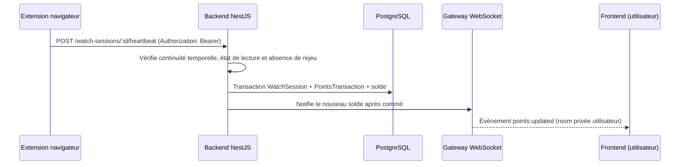
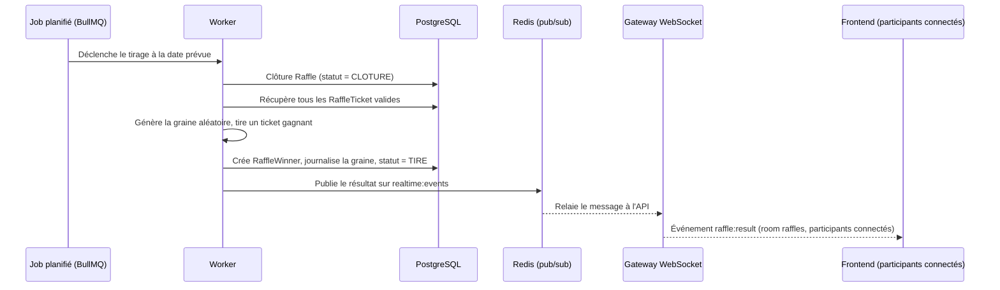
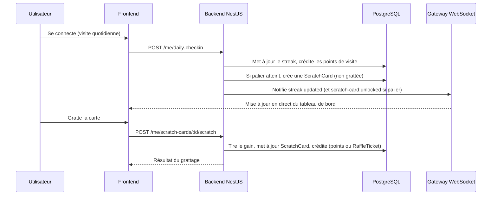

# 02. Architecture technique

## Vue d'ensemble

```text
      ┌────────────────────┐
      │ Extension           │  (Chrome/Firefox, hors Docker)
      │ navigateur          │──────────┐
      └────────────────────┘          │ heartbeats
                                       │ authentifiés
                       ┌──────────────────────┐
                       │   Reverse proxy       │
                       │  Traefik (TLS auto)   │
                       └──────────┬───────────┘
                                  │
              ┌───────────────────┼───────────────────┐
              │                   │                   │
      ┌───────▼───────┐   ┌───────▼───────┐   ┌───────▼───────┐
      │   Frontend     │◀─▶│  Backend API  │   │   Worker      │
      │  Next.js (SSR) │ WS │  NestJS       │   │  BullMQ jobs  │
      │                │   │  + Gateway WS  │   │               │
      └───────┬───────┘   └───────┬───────┘   └───────┬───────┘
              │                   │                   │
              └───────────┬───────┴───────────┬───────┘
                          │                   │
                  ┌───────▼───────┐   ┌───────▼───────┐
                  │  PostgreSQL   │   │     Redis     │
                  └───────────────┘   └───────────────┘
```

Le flux WS est bidirectionnel entre le frontend et le backend (le backend
pousse les mises à jour ; le frontend n'a pas besoin d'émettre d'événements
métier via ce canal). Redis sert aussi d'adaptateur pub/sub pour le
WebSocket, notamment pour propager les révocations de sessions entre
instances.

L'extension navigateur n'est pas conteneurisée (elle s'exécute dans le
navigateur de l'utilisateur) mais fait partie du même dépôt et du même
pipeline CI que le reste (voir [08-docker-infra.md](08-docker-infra.md)
pour ce que Docker couvre réellement).

## Cartographie du code et trajectoire de refactor

**État : proposition de refactor, sans changement de stack.** Cette cartographie
décrit le dépôt `dev` observé le 2026-11-18. La readiness globale de conception
reste `review`; les changements structurels de code attendent la validation de
la proposition et de leurs critères ciblés.

Le périmètre de cette refactorisation est interne : les routes, contrats,
fonctionnalités, règles d'autorisation, données, rendu et actifs restent
inchangés. Les décisions métier et conformité encore ouvertes dans le registre
de conception restent explicitement hors de ce work item; leur statut n'est ni
résolu ni modifié ici. La stack existante est conservée.

| Zone | Organisation observée | Direction de refactor proposée |
| --- | --- | --- |
| Frontend | Next.js App Router sous `frontend/src/app/`; composants regroupés par domaines sous `frontend/src/components/`; accès API et utilitaires partagés sous `frontend/src/lib/`. | Garder les routes comme composition de page, rapprocher les composants, hooks et appels métier de leur domaine quand cela réduit les imports transversaux. Préserver les routes, l'API et l'interface existantes. |
| API | Monolithe NestJS organisé en modules de domaine sous `backend/src/` (auth, visionnage, streams, récompenses, tirages, boutique et administration), avec DTO, guards et services. Prisma/PostgreSQL portent les transactions et l'état durable; l'injection de Prisma et certains agrégats traversent actuellement plusieurs modules. | Garder le monolithe modulaire. Introduire progressivement des interfaces ou services de domaine exportés pour les dépendances inter-domaines identifiées, en les recensant avant extraction. Garder les accès Prisma directs là où les transactions les exigent; ne pas séparer les services en microservices. |
| Worker | `backend/src/worker.ts` initialise son client Prisma et ses files BullMQ; il exécute explicitement les tirages planifiés et la maintenance. Les heartbeats sont traités par l'API. | Garder un processus worker séparé et conserver les points d'entrée métier et relais Socket.io explicites. Documenter et vérifier les garanties transactionnelles ou d'idempotence propres à chaque job, sans supposer qu'elles sont communes à tous. Ne pas déplacer le traitement du visionnage. |
| Extension | Package TypeScript autonome avec build esbuild; popup, script de contenu et service worker sont séparés sous `extension/src/`. Le build copie actuellement le wordmark et les icônes depuis `frontend/assets/extension/` (`extension/scripts/build.mjs` et `extension/Dockerfile.e2e-browser`). | Découpler à terme la construction de l'extension des dépendances de fichiers frontend, tout en conservant les médias utilisés, leurs empreintes et le contenu exact du paquet produit. Aucun déplacement ni suppression n'est inclus dans cette proposition. |
| Contrat HTTP | `docs/04-api-contract.md` décrit le périmètre fonctionnel des endpoints, mais précise que les schémas détaillés request/response restent à compléter. Le frontend et l'extension ont chacun leur client et leurs chemins d'API. | Compléter et valider les schémas détaillés à partir des DTO NestJS avant de traiter ce document comme contrat de référence. Recenser ensuite les écarts des deux clients et ajouter un contrôle ciblé; n'introduire ni générateur ni nouvel outil sans nécessité démontrée. Toute évolution de route reste compatible ou versionnée. |
| Présentation responsive | Des règles desktop et mobile existent. L'effet réel de la largeur sur les compositions est une observation à qualifier sur les écrans concernés; le viewport Mac de référence n'est pas encore consigné. | Avant un lot visuel, enregistrer le viewport Mac et les écrans concernés. Préserver sur desktop la composition et les espacements de cette référence, sans étirer ni rapprocher les blocs; garder une composition mobile dédiée. |

### Ordre des lots

1. Corriger les descriptions et commentaires qui contredisent le code actuel;
   cette passe documentaire n'altère aucun comportement.
2. Après approbation de conception, isoler les dépendances de build de
   l'extension et vérifier que le paquet produit conserve ses chemins et ses
   actifs utilisés.
3. Compléter les schémas détaillés du contrat à partir des DTO, puis comparer
   les deux clients à ce contrat sans changer les routes ni les formats des
   échanges. Définir un contrôle de dérive ciblé avant d'envisager un générateur.
4. Appliquer la règle desktop de composition stable et la mise en page mobile
   dédiée dans un lot frontend distinct, après capture du viewport de référence.
5. Supprimer uniquement les fichiers dont l'inutilité, l'absence de références
   actives et l'absence de valeur historique sont établies indépendamment.

Cette trajectoire est incrémentale : elle conserve le monorepo et les
technologies actuelles, notamment Next.js/React, NestJS, Prisma/PostgreSQL,
WebExtension MV3, Docker, Redis/BullMQ, Socket.io, Traefik et GitHub Actions.
Elle ne crée pas un dépôt de remplacement et ne modifie pas les fonctionnalités
métier.

### Candidats de premier lot, en attente de revue de conception

Ces deux changements sont des candidats indépendants et ne doivent pas être
regroupés dans une même PR. Ils ne sont pas autorisés à commencer avant la
levée du gate DESIGN-FIRST.

#### Backend : découplage Auth et Realtime

La portée minimale d'ADR-017 est maintenant implémentée localement et consignée
dans [ADR-017](design/adr-017-auth-realtime-module-boundary.md). Le
`AuthRuntimeModule` configure et exporte le `JwtModule` et l'unique provider
`SessionRevocationService`; `AuthModule` le ré-exporte et `RealtimeModule`
l'importe directement. Les deux modules ne s'importent plus mutuellement et
aucun `forwardRef` n'est nécessaire pour cette frontière. Le provider de
révocation reste partagé.

Avant ce changement, `AuthModule` et `RealtimeModule` s'importaient via
`forwardRef`. `AuthService` dépend de `RealtimeService`; en sens inverse,
`RealtimeGateway` dépend de `SessionRevocationService` et de `JwtService`.

Les options antérieurement comparées restent consignées ici comme contexte :
garder les deux `forwardRef` ou déplacer seulement le service de révocation ne
supprimait pas le cycle; ré-enregistrer `JwtModule` dans Realtime dupliquerait
le secret et les options de signature/vérification. L'option retenue est le
module runtime étroit décrit ci-dessus.

L'implémentation conserve `session-revocation.service.ts` à son chemin actuel;
seul son module propriétaire change. Cela évite les réécritures d'import dans
`AuthService`, `RealtimeGateway` et `AdminUsersService`. `AuthRuntimeModule`
fournit une seule instance du service. Aucun endpoint, DTO, payload,
transaction, ordre de révocation ou effet socket n'a changé.

Validations ciblées de l'implémentation locale :

```bash
cd backend
npx jest src/auth/auth.service.spec.ts src/auth/auth.password.spec.ts src/realtime/realtime.gateway.spec.ts src/admin-users/admin-users.service.spec.ts --runInBand
npm run typecheck
npm run build
```

QA rapporte cinq suites ciblées réussies (40 tests), `typecheck` et `build`
réussis. Le test de composition Nest confirme l'absence de cycle et l'identité
de l'instance de révocation partagée sans base réelle ni socket réseau. Ces
contrôles ciblés ne valent pas approbation globale; `design-readiness` reste
`review`. Les invariants incluent `JWT_SECRET` identique, expiration `24h`,
ordre actuel inscription/notification/session, révocation globale après la
transaction de changement de mot de passe, révocation limitée au `sessionId`
courant à la déconnexion, appels synchrones des auditeurs, ainsi que routes,
autorisations, événements et données inchangés.

Rollback : si le démarrage Nest ou les suites ciblées échouent, restaurer les
imports/providers d'origine dans `AuthModule` et `RealtimeModule`, retirer
`AuthRuntimeModule`, puis relancer les mêmes commandes. Aucun changement de
données ni migration n'est prévu. Cette correction ciblée reste distincte des
autres lots; elle ne ferme pas le gate global, ne constitue pas une approbation
globale et n'autorise aucune extension de portée.

#### Frontend : isoler les données du cockpit admin

`frontend/src/app/admin/page.tsx` combine le rendu avec le chargement du résumé,
la normalisation des collections, les états chargement/erreur/réessai et les
abonnements temps réel. Dans `Cockpit`, les imports concernés sont
`ErreurApi` depuis `@/lib/api`, `recupererResumeDashboardAdmin` et
`AdminDashboardSummary` depuis `@/lib/admin`, ainsi que `connecterTempsReel`,
`EVENEMENT_UTILISATEURS_INSCRITS`, `EVENEMENT_TIRAGE_STATUT` et
`EVENEMENT_RESULTAT_TIRAGE` depuis `@/lib/temps-reel`. Le test existant est
`frontend/src/app/admin/page.test.tsx`.

**Options :** garder le cycle de données dans la route (statu quo, aucun risque
de déplacement mais le couplage rendu/données subsiste); extraire ce cycle dans
`frontend/src/components/admin/useAdminCockpitSummary.ts` (option proposée,
frontière de domaine étroite); ou décomposer en plus le rendu en cartes et
sous-composants (écarté pour ce premier lot, car cela élargirait le diff et
mêlerait deux axes de refactor).

L'option proposée fait porter au hook le chargement initial, les états de
chargement et d'erreur, la normalisation du résumé, la relance, les abonnements
aux trois événements et leur nettoyage. La route reste la composition du
cockpit. Les textes FR/EN, le JSX/DOM, styles, ordre des sections, liens,
routes, clients API et contrats restent dans leur état actuel.

**Invariants :** préserver l'appel initial différé par `setTimeout(0)`; les
listes `raffles`, `lots`, `announcements` et `fraudFlags` sont normalisées en
tableaux vides si absentes; conserver le message de `ErreurApi` et le message
générique pour les autres exceptions, le comportement de chargement/réessai et
l'actualisation sur les trois événements nommés ci-dessus. Au démontage,
retirer ces écouteurs et déconnecter le socket. A données identiques, aucun
changement DOM observable n'est attendu.

**Validations ciblées proposées**, depuis `frontend/` après levée du gate et
implémentation :

```sh
npx vitest run src/app/admin/page.test.tsx
npx eslint src/app/admin/page.tsx src/components/admin/useAdminCockpitSummary.ts
npm run typecheck
```

Le test du cockpit doit couvrir résumé rendu, état vide et erreur récupérable;
compléter sa couverture ciblée par les événements, la suppression des
écouteurs et la déconnexion au démontage. Aucun audit navigateur, responsive,
accessibilité globale ou performance n'est prévu pour cette extraction.

**Rollback :** annuler le nouveau hook et rétablir dans
`frontend/src/app/admin/page.tsx` les imports, états et effets du cycle de
données. Aucun changement de route, contrat, stockage ou migration n'appelle
d'action de retour supplémentaire.

### Invariants et critères de sortie

Chaque lot de refactor doit préserver les invariants suivants :

- les routes publiques, les formats HTTP, les codes de réponse, les règles
  d'autorisation et les comportements métier ne changent pas;
- les transactions PostgreSQL et leur frontière restent explicites; aucun
  accès réseau, envoi d'événement ou effet externe n'est déplacé à l'intérieur
  d'une transaction sans justification;
- le worker reste un processus séparé; aucun heartbeat ni crédit de visionnage
  n'est déplacé vers BullMQ;
- l'extension conserve son manifeste, ses permissions, ses points d'entrée, ses
  chemins d'actifs et son comportement de stockage; son archive construite doit
  rester reproductible et ne contenir que les fichiers requis;
- les fichiers qui portent une valeur historique ou de preuve restent en place.
  Une suppression exige une recherche de références actives, une vérification
  des usages de build et une justification écrite dans le même work item.

| Lot | Critères de sortie observables |
| --- | --- |
| Extension autonome | Le build ne dépend plus d'un chemin source du frontend; manifeste et permissions sont inchangés; les actifs empaquetés existent, leurs empreintes sont relevées et les scénarios de popup, contenu et service worker passent. |
| Frontend par domaine | Les routes restent de la composition et délèguent aux domaines concernés; les imports transversaux réduits sont recensés; chaque parcours déplacé garde ses états chargement, vide, erreur et succès, ses URL et ses appels API. |
| Modules backend | Les dépendances inter-domaines sont explicites et orientées vers les contrats exportés; les cycles introduits par le lot sont absents; la signature des endpoints et les garanties transactionnelles restent identiques. |
| Contrat et clients HTTP | Les schémas request/response dérivent des DTO existants; frontend et extension sont comparés aux routes réellement servies; aucun générateur n'est ajouté sans preuve d'un besoin et d'une stratégie de dérive. |
| Composition desktop/mobile | La référence Mac est consignée avant le changement; la composition desktop reste stable entre écrans; le mobile garde une mise en page propre; les captures ciblées montrent les deux variantes. |

Un lot n'est accepté qu'après comparaison du diff à `dev`, contrôles directement
liés à ses fichiers, vérification des contrats concernés et relecture indépendante
des suppressions ou des frontières modifiées. Une mesure de performance n'est
requise que si le lot change un chemin d'exécution ou un volume mesurable; elle
doit comparer le même parcours avant/après. Ces critères décrivent les preuves
à produire pendant l'implémentation et ne valent pas approbation de conception.

## Choix de stack (ADR-001)

| Composant                | Choix                                                                                                                 | Justification                                                                                                                                                                                                                                                                                                                                    |
| ------------------------ | --------------------------------------------------------------------------------------------------------------------- | ------------------------------------------------------------------------------------------------------------------------------------------------------------------------------------------------------------------------------------------------------------------------------------------------------------------------------------------------ |
| Frontend                 | Next.js (React + TypeScript) + TailwindCSS                                                                            | SSR pour le référencement des pages publiques (tirages, lots), écosystème riche pour un design system custom, TypeScript partagé avec le backend.                                                                                                                                                                                                |
| Backend                  | NestJS (Node.js + TypeScript)                                                                                         | Structure modulaire, guards/interceptors natifs adaptés aux besoins de l'agent cybersécurité (rate limiting, validation), même langage que le frontend pour limiter le contexte switch entre agents.                                                                                                                                             |
| Base de données          | PostgreSQL + Prisma ORM                                                                                               | Transactions fiables nécessaires pour la comptabilité des points et des tickets, migrations versionnées avec Prisma.                                                                                                                                                                                                                             |
| Files d'attente et diffusion | Redis + BullMQ                                                                                                  | BullMQ exécute les tirages planifiés et la maintenance périodique. Redis sert aussi au relais pub/sub Socket.io. Les heartbeats sont traités directement par l'API, pas agrégés par BullMQ.                                                                                                                                                         |
| Authentification         | Formulaire natif email/mot de passe + JWT de session                                                                  | La connexion et l'inscription Skkup sont natives; le watch time repose sur l'extension, pas sur une connexion d'identité aux plateformes.                                                                                                                                                                                                        |
| Infra                    | Docker Compose, reverse proxy Traefik avec TLS Let's Encrypt                                                          | Portable sur un VPS auto-géré, pas de dépendance à un cloud managé.                                                                                                                                                                                                                                                                              |
| CI                       | GitHub Actions                                                                                                        | Lint, typecheck, tests, build des images Docker, obligatoire avant merge sur dev et main.                                                                                                                                                                                                                                                        |
| Extension navigateur     | WebExtension (Manifest V3) en TypeScript, polyfill `webextension-polyfill` pour la compatibilité Chrome/Firefox/Opera | Un seul code source pour les navigateurs cibles, TypeScript cohérent avec le reste du projet. **V1.0 : publication Chrome uniquement, Firefox et Opera en V1.1** (le polyfill est gardé dès le V1.0 pour limiter les adaptations lors des publications différées).                                                                               |
| Temps réel               | WebSocket via NestJS Gateway (Socket.io)                                                                              | Pousse au frontend les mises à jour de solde de points, de streak, de cartes à gratter débloquées et de résultats de tirage sans que l'utilisateur ait à recharger la page. Socket.io choisi pour la gestion native des rooms (une par utilisateur, une par tirage) et son adaptateur Redis pour passer à plusieurs instances backend si besoin. |

### Alternatives considérées

- Django/Python au lieu de NestJS : écarté pour garder un langage unique (TypeScript) entre front et back, ce qui simplifie la coordination entre les agents frontend et backend.
- MongoDB au lieu de PostgreSQL : écarté car la comptabilité de points/tickets bénéficie fortement des transactions ACID et de contraintes relationnelles strictes.
- Cloud managé (AWS/GCP) : écarté à ce stade suite au choix du client (VPS auto-géré), mais l'architecture Docker Compose reste portable vers un cloud managé si besoin en V2.

## Extension navigateur : mesure du watch time (décision d'architecture critique)

Aucune plateforme (Twitch, YouTube, Kick) n'expose d'API publique
donnant le temps de visionnage d'un utilisateur précis sur un stream. Le
cahier des charges client confirme qu'une extension navigateur doit être
développée ; elle devient le mécanisme principal de mesure du watch time,
sans lecteur embarqué : l'extension navigateur est l'unique mécanisme de suivi.
La décision produit du 22 octobre 2026 retient Twitch, YouTube et Kick pour le
MVP. Facebook n'est pas une plateforme de visionnage cible; sa présence
éventuelle dans le schéma de données est un élément historique de compatibilité.

### Mécanisme principal : extension navigateur

1. L'utilisateur installe l'extension (Chrome pour le lancement V1.0,
   Firefox et Opera ajoutés en V1.1) et l'associe à son compte SKUP via un token
   d'appariement généré depuis le
   site (code d'appariement à usage unique, sans exposer le mot de passe à
   l'extension).
2. L'extension détecte, depuis un script de contenu injecté sur les pages
   de twitch.tv, youtube.com et kick.com, qu'une page de visionnage
   est ouverte et que son onglet est réellement au premier plan (pas
   seulement ouvert en arrière-plan). L'implémentation n'utilise
   finalement ni `tabs` ni `webNavigation`, envisagés au moment de la
   conception : observer la page depuis l'intérieur suffit et évite de
   demander des permissions qui donneraient accès à l'historique de
   navigation (voir « Implémentation de l'extension » plus bas).
3. Tant que ces conditions sont réunies, l'extension envoie des heartbeats
   au backend selon une cadence irrégulière définie dans
   `extension/src/commun/cadence.ts`. Elle transmet l'état de lecture associé
   à la session; le serveur calcule l'intervalle depuis sa propre horloge.
4. L'API valide chaque heartbeat dans `WatchSessionsService`, puis met à jour
   la session, la durée validée et les éventuels crédits dans une transaction
   Prisma/PostgreSQL. La source `EXTENSION` est la seule source qui crédite
   actuellement des points. Les anciennes sessions `LECTEUR_EMBARQUE` peuvent
   encore être clôturées, mais elles ne créditent aucun point. Le traitement
   du heartbeat n'est pas un job BullMQ.
5. L'extension ne prétend pas exposer une métrique officielle Twitch ou
   YouTube : elle mesure une présence active de l'utilisateur sur une page
   de stream, ce qui reste défendable au regard des conditions
   d'utilisation de ces plateformes (voir aussi
   [05-security.md](05-security.md) pour les limites de confidentialité à
   respecter dans les permissions demandées).

### Implémentation de l'extension (V1.0)

Le code vit dans `extension/`, à la racine du dépôt, avec son propre
`package.json` : ce n'est ni une application Next.js ni un service
conteneurisé, et son outillage (esbuild, pas de framework) n'a rien à
voir avec celui du frontend. Elle a en revanche son propre job dans la
CI, au même titre que le frontend et le backend
([07-ci-cd.md](07-ci-cd.md)).

```text
extension/src/manifeste.ts    Manifeste MV3 construit au build
extension/src/commun/         Client HTTP porteur du jeton, endpoints, stockage
extension/src/contenu/        Script de contenu : détection de lecture
extension/src/arriere-plan/   Service worker : orchestration des sessions
extension/src/popup/          Popup d'association du compte
```

Décisions structurantes :

- **Permissions minimales** : `storage` et `alarms`, plus une unique
  permission d'hôte pour l'origine de l'API. Les trois plateformes ne
  figurent que dans `content_scripts.matches`, ce qui suffit à injecter
  le script sans accorder l'accès à leurs cookies ni le droit d'émettre
  des requêtes en leur nom. Aucune permission ne donne accès à
  l'historique de navigation.
- **Manifeste généré au build** : la permission d'hôte doit être écrite
  en clair dans le paquet publié et ne peut pas être calculée à
  l'exécution. La générer depuis l'URL d'API du build garantit qu'elle
  correspond exactement à l'origine appelée.
- **Répartition des rôles** : le script de contenu observe et ne connaît
  ni l'API ni le jeton ; le service worker détient le jeton et parle à
  l'API. Un script exécuté dans une page tierce n'a ainsi aucun
  credential à portée de main.
- **État en `storage.session`** : le service worker MV3 est arrêté dès
  qu'il est inactif, aucune variable en mémoire ne survit. L'état de
  suivi est donc persisté, mais dans un stockage non écrit sur disque et
  vidé à la fermeture du navigateur. Seul le jeton d'appariement va dans
  `storage.local`, parce qu'il doit survivre aux redémarrages.
- **Cadence irrégulière aux deux étages** : le script de contenu pousse
  son état toutes les 10 à 16 secondes (ce qui réveille le service
  worker), qui envoie un heartbeat une fois écoulé un délai de 40 à
  50 secondes. Les deux tirages sont nécessaires : le heartbeat part au
  premier signal reçu après l'échéance du délai, donc une période de
  signal fixe ramènerait tous les heartbeats sur la même grille et le
  serveur mesurerait un intervalle constant malgré la gigue du délai.
  Or le backend invalide une session dont cinq intervalles consécutifs
  sont rigoureusement identiques. L'écart maximal possible (66 secondes)
  reste sous le plafond de plausibilité de 90 secondes.

Le jeton d'appariement est accepté par les routes protégées
`POST /watch-sessions`, `POST /watch-sessions/:id/heartbeat` et
`POST /watch-sessions/:id/close`. La garde de credential distingue la
session web portée par le cookie du jeton opaque présenté par l'extension
dans l'en-tête `Authorization: Bearer`. La source de la session est dérivée
côté serveur depuis ce credential et ne provient jamais du payload client.
Les sessions ouvertes depuis une extension appariée active peuvent donc
créditer des points. Les anciennes sessions de lecteur embarqué restent
clôturables sans crédit. La révocation d'un appareil est prise en compte immédiatement
par la garde d'extension (voir [05-security.md](05-security.md), section
« Appariement de l'extension navigateur »).

### Lecteurs embarqués : hors périmètre V1

La V1 ne propose aucun lecteur Twitch, YouTube ou Kick dans le site.
L'utilisateur ouvre le direct de son choix sur la plateforme officielle et
l'extension Skkup mesure le visionnage actif. Cette décision évite d'imposer
un catalogue fermé et concentre les contrôles anti-fraude sur le mécanisme
réellement livré.

Les composants techniques historiques du lecteur restent isolés pour une
éventuelle réévaluation ultérieure, mais ne sont ni montés par la page
Streams ni créditables en V1.

Les anciennes sessions de lecteur sont conservées uniquement pour permettre
une migration propre des données. Elles ne produisent aucun point.

### Diagramme de séquence : heartbeat de visionnage



### Points ouverts à clarifier avec le client avant l'implémentation

- ~~Permissions exactes demandées par l'extension~~ : tranché à
  l'implémentation, voir « Implémentation de l'extension » ci-dessus
  (`storage`, `alarms`, une permission d'hôte pour l'API, et les trois
  plateformes uniquement en motifs de script de contenu).
- Politique des stores (Chrome Web Store, Firefox Add-ons) concernant les
  extensions qui mesurent du temps de présence : disclosure claire dans la
  fiche de l'extension, page de confidentialité dédiée.
- Comportement si l'extension est désinstallée ou désactivée en cours de
  session (pas de perte de points déjà crédités, juste arrêt des futurs
  heartbeats).

Fonctionnalités écartées de la V1 pour cette raison :

- Twitch Extensions officielles (nécessitent l'installation par le
  streamer partenaire, mesurent une présence approximative, à ne pas
  confondre avec notre propre extension navigateur ci-dessus).
- Twitch Drops (réservé aux organisateurs approuvés par Twitch, processus
  de partenariat non accessible à un site tiers indépendant).

## Temps réel (WebSocket)

Certaines informations doivent se mettre à jour instantanément côté
utilisateur sans rechargement de page :

- solde de points après un heartbeat de visionnage validé ou une visite
  quotidienne ;
- progression de streak et déblocage d'une carte à gratter ;
- compte à rebours et statut d'un tirage (ouvert, clôturé, tiré) ;
- annonce du résultat d'un tirage aux participants connectés.

Le backend NestJS expose une Gateway WebSocket (Socket.io). Chaque
utilisateur authentifié rejoint une room privée (son propre canal) à la
connexion, via le même JWT que pour les appels REST (poignée de main
authentifiée, pas de canal anonyme). Les tirages ont aussi une room dédiée
pour diffuser l'ouverture, la clôture et le résultat à tous les
participants connectés en simultané.

Lorsqu'un heartbeat crédite des points après commit, l'API notifie le solde
actualisé via la Gateway Socket.io. Le worker BullMQ publie le résultat des
tirages via le relais Redis; il exécute aussi la maintenance périodique. Aucun
worker n'agrège actuellement le watch time. Le WebSocket est une notification
de ce qui vient d'être écrit, jamais la source de vérité elle-même (celle-ci
reste PostgreSQL). Si la connexion WebSocket d'un
utilisateur est coupée, un rafraîchissement classique via l'API REST reste
toujours possible : le temps réel est un confort, pas une dépendance
bloquante.

Voir [05-security.md](05-security.md) pour l'authentification et le rate
limiting des connexions WebSocket, et
[08-docker-infra.md](08-docker-infra.md) pour la question de la montée en
charge (adaptateur Redis) si plusieurs instances du backend sont un jour
nécessaires.

### Implémentation de la Gateway

- **Poignée de main** : le JWT est lu dans le champ `auth.token` de la
  poignée de main Socket.io, à défaut dans l'en-tête `Authorization:
Bearer`. Jamais dans la query string, qui finit dans les journaux
  d'accès du reverse proxy. Token absent, expiré, mal signé ou sans
  `sub` exploitable : la socket est déconnectée immédiatement, il
  n'existe aucun canal anonyme.
- **Room privée** : `user:<userId>`, où `userId` est le `sub` du JWT
  vérifié. Le client ne transmet jamais l'identifiant de la room qu'il
  rejoint, ce qui exclut par construction l'accès au canal d'un autre
  utilisateur.
- **Room des tirages** : choix V1.0, une room commune `raffles` que tout
  utilisateur authentifié rejoint automatiquement, le `raffleId` étant
  porté par le payload de l'événement. Les données diffusées sont celles
  déjà exposées publiquement par `GET /raffles/:id/result` (jamais
  d'identifiant utilisateur), il n'y a donc rien à cloisonner. Une room
  par tirage avec abonnement explicite reste possible plus tard sans
  changer les payloads.
- **Connexions simultanées** : plafonnées par utilisateur (10), au-delà
  la connexion est refusée (menace 4 de [05-security.md](05-security.md)).
- **Origines** : la poignée de main n'accepte que les origines listées
  dans `CORS_ORIGINS`. Variable vide, aucune origine tierce n'est admise.
- **Publication depuis le worker** : le worker BullMQ tourne dans un
  processus distinct et n'héberge pas de serveur Socket.io. Il publie ses
  notifications sur le canal Redis `realtime:events`, que le processus
  API relaie aux clients connectés après avoir vérifié le nom de la room
  et la présence de l'événement dans une liste blanche. Un échec de
  publication est journalisé sans faire échouer le traitement, qui est
  déjà committé en base.

### Client frontend

Le tableau de bord viewer (`frontend/src/app/dashboard`) charge ses
données au montage par l'API REST (`GET /me`, historique de points,
cartes à gratter, tickets de tirage), puis ouvre une connexion Socket.io
(`frontend/src/lib/temps-reel.ts`) qui rejoint automatiquement la room
privée de l'utilisateur (le cookie de session httpOnly est joint à la
poignée de main via `withCredentials`). Les événements `points:updated`,
`streak:updated` et `scratch-card:unlocked` patchent directement l'état
local du composant plutôt que de redéclencher un appel REST. Si la
connexion échoue ou se coupe, la page reste utilisable avec les données
déjà chargées : conformément au principe ci-dessus, le frontend ne
retente pas de reconnexion agressive ni n'affiche d'erreur bloquante
pour cette seule raison.

## Modèle de tirage au sort

Un job planifié (BullMQ) exécute le tirage à date fixe : sélection aléatoire parmi les tickets valides, avec graine aléatoire journalisée pour permettre un audit a posteriori. Le résultat est stocké de façon immuable (table d'historique des tirages) et publié sur le site.

### Diagramme de séquence : exécution du tirage



### Implémentation du moteur de tirage

- **Planification** : le worker BullMQ vérifie chaque minute les tirages
  en statut `OUVERT` dont `dateTirage` est dépassée. La date exacte reste
  portée par la base, pas par la planification : un worker redémarré
  rattrape automatiquement un tirage manqué à la vérification suivante.
- **Graine** : 32 octets issus de `crypto.randomBytes` (CSPRNG), générés
  au moment du tirage puis journalisés dans `Raffle.graineAleatoire` avec
  le résultat. `Math.random` est exclu : il est prédictible et donc
  inadapté à un tirage dont l'intégrité doit être défendable.
- **Sélection** : les tickets sont triés par identifiant, puis tirés sans
  remise à partir d'un flux SHA-256 dérivé de la graine (rejet des valeurs
  hors plage pour éviter le biais du modulo). Un même ticket ne peut donc
  pas gagner deux lots. La sélection ne dépend que du couple (graine,
  liste des tickets) : à partir de la graine et de la liste publiées,
  n'importe qui peut rejouer le tirage et vérifier les gagnants.
- **Liste des participants** : l'empreinte SHA-256 de la liste ordonnée
  des tickets présents dans le chapeau est calculée dans la même
  transaction que le tirage et journalisée dans
  `Raffle.empreinteParticipants`, avec son volume dans
  `Raffle.nombreParticipants`. L'encodage préfixe chaque identifiant par
  sa longueur, de sorte que deux listes distinctes ne peuvent pas
  produire la même empreinte. La liste elle-même est publiée après le
  tirage sur `GET /raffles/:id/participants` : sans elle, la graine
  seule ne permet aucune vérification indépendante, et tout ajout ou
  retrait de ticket postérieur à la publication devient détectable.
- **Atomicité** : clôture, tirage, création des `RaffleWinner` et passage
  en `TIRE` se font dans une seule transaction Prisma. La clôture est un
  `updateMany` conditionné au statut `OUVERT`, ce qui empêche deux workers
  concurrents de tirer deux fois le même tirage.
- **Notification** : l'exécution expose un point d'extension appelé après
  le commit, sur lequel est branché `raffle:result` (le temps réel
  notifie ce qui est déjà écrit, il n'est jamais la source de vérité).
  Le worker n'ayant pas de serveur Socket.io, il publie sur le canal
  Redis relayé par la Gateway (voir la section temps réel ci-dessus).
- **Consultation** : `GET /raffles`, `GET /raffles/:id`,
  `GET /raffles/:id/result` et `GET /raffles/:id/participants` sont
  publics (voir [04-api-contract.md](04-api-contract.md)). Les deux
  derniers répondent `404` tant que le tirage n'est pas en statut `TIRE`.
- **Limite connue** : la graine est générée au moment du tirage, sans
  engagement public préalable. Le dispositif prouve donc la
  reproductibilité du tirage, pas l'impossibilité pour l'exploitant
  d'avoir choisi la graine. Voir [05-security.md](05-security.md),
  menace 6, pour le risque résiduel et la cible.

### Diagramme de séquence : carte à gratter (streak)



## Documents liés

- [03-data-model.md](03-data-model.md) : détail des entités (utilisateurs, comptes liés, sessions de visionnage, points, tickets, tirages, lots)
- [04-api-contract.md](04-api-contract.md) : endpoints et contrat d'authentification native
- [05-security.md](05-security.md) : menaces et mitigations
- [08-docker-infra.md](08-docker-infra.md) : topologie Docker détaillée
