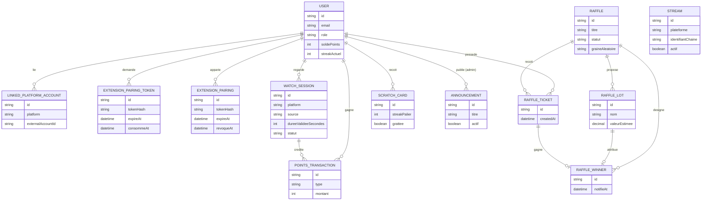

# 03. Modèle de données

Ce document décrit le contrat conceptuel et, dans la matrice ACT-03 ci-dessous, l'état observé du schéma et du code applicatif textuels. Les champs effectivement implémentés sont définis dans `backend/prisma/schema.prisma`; les finalités de la matrice sont des déductions techniques à partir des noms et usages du code, pas des finalités ou règles juridiques approuvées.

## Diagramme entité-relation

## Entités principales

### User

- id, email, mot de passe (hash), pseudo, date de création
- role (`VIEWER` par défaut, `ADMIN`) : conditionne l'accès aux
  endpoints `/admin/*`. Aucun endpoint ne permet à un compte de
  s'auto-élever ; voir docs/05-security.md pour le mécanisme de
  désignation du premier administrateur.
- streak_actuel, streak_max, derniere_visite_at
- solde_points

### LinkedPlatformAccount

- id, user_id, plateforme (twitch, youtube, facebook)
- identifiant externe, credential de plateforme chiffré, date de liaison
- Entité réservée à une future liaison de plateforme, jamais utilisée pour
  l'inscription ou la connexion V1.0 qui restent natives.

### ExtensionPairingToken (code d'appariement)

- id, user_id, token_hash (empreinte SHA-256 du code, jamais le code),
  expire_at, consomme_at, created_at
- Code à usage unique généré par `POST /extension/pairing-token` et saisi
  dans l'extension. Durée de vie courte (5 minutes) ; `consomme_at`
  matérialise l'usage unique, la consommation étant conditionnée à
  `consomme_at IS NULL` pour rester atomique face à deux échanges
  simultanés.

### ExtensionPairing (appareil apparié)

- id, user_id, token_hash (empreinte SHA-256 du jeton d'accès),
  expire_at, revoque_at, created_at
- Jeton opaque de longue durée (30 jours) que l'extension présente en
  `Authorization: Bearer`. Volontairement pas un JWT : `revoque_at`
  permet de couper l'accès d'un appareil immédiatement, ce qu'un jeton
  signé ne permettrait qu'à son expiration. Plafond de 5 appareils actifs
  par compte, les plus anciens étant révoqués au-delà.

### WatchSession

- id, user_id, plateforme, identifiant du stream
- debut_at, dernier_heartbeat_at, duree_validee_secondes
- statut (en_cours, terminee, invalidee)
- dernier_intervalle_secondes, intervalles_identiques_consecutifs :
  champs anti-fraude, utilisés pour détecter des heartbeats envoyés à un
  intervalle rigoureusement identique (signature d'un script), voir
  [05-security.md](05-security.md).

### Stream

- id, plateforme (twitch, youtube, facebook), identifiant de la chaîne,
  nom affiché, actif (booléen), created_at
- Catalogue des streams disponibles proposés sur le site, servi par
  `GET /streams`. Tous les streams valides sont accessibles aux viewers ; le
  statut partenaire est une option de bonus, pas une condition d'accès. En V1.0 il est renseigné manuellement (seed puis
  back-office administrateur) : la récupération automatique des lives via
  les API des plateformes suppose les intégrations OAuth, prévues plus
  tard. Le drapeau `actif` permet de retirer une chaîne de l'affichage
  sans supprimer son historique.

### PointsTransaction

- id, user_id, type (visite_quotidienne, watch_time, carte_a_gratter, ajustement_admin)
- montant, reference (par exemple watch_session_id), created_at

### Raffle (tirage au sort)

- id, titre, description, date_ouverture, date_tirage
- statut (ouvert, cloture, tire)
- graine_aleatoire, resultat_publie_at

### RaffleLot (lot)

- id, raffle_id, nom, valeur_estimee, quantite, fournisseur

### RaffleTicket

- id, raffle_id, user_id, created_at
- En V1.0, un ticket provient uniquement d'un gain de `ScratchCard` (pas de
  conversion directe de points, voir [01-features.md](01-features.md)).

### RaffleWinner

- id, raffle_id, lot_id, ticket_id, user_id, notifie_at

### ScratchCard (carte à gratter)

- id, user_id, streak_palier (palier de streak ayant débloqué la carte)
- grattee (booléen), gain_type, gain_montant, created_at, grattee_at

### Announcement

- Schéma observé : id, titre, texte, `actif` (booléen), `debut_at`, `fin_at`,
  `created_by` (admin), `created_at`; aucun statut brouillon distinct n'est
  encore implémenté.
- Cible de conception : statut `DRAFT | PUBLISHED | ARCHIVED`; création en
  `DRAFT`, publication explicite, archivage réversible et restauration au
  statut pré-archivage quand celui-ci est prouvé. Les valeurs historiques
  `actif=true` deviennent `PUBLISHED` et `actif=false` deviennent `ARCHIVED`
  sans republication automatique. Voir
  [le cycle de vie des annonces](design/announcement-lifecycle-2026-10-22.md).

### Sponsors et signalements anti-fraude

- `Sponsor` : id, nom, logo_url optionnelle, actif, created_at. Un lot peut
  référencer un sponsor ; la suppression du sponsor détache le lot sans le
  supprimer.
- `FraudFlag` : id, user_id, watch_session_id optionnel, type, details,
  statut (`OUVERTE`, `EXAMINEE`, `IGNOREE`), created_at et examinee_at.
  Les détails servent à l'analyse interne et ne sont jamais exposés aux
  utilisateurs. Un administrateur peut seulement changer le statut.

## Contraintes clés à respecter

- Toute variation de `solde_points` doit passer par une `PointsTransaction`
  (source de vérité auditable, pas de mise à jour directe du solde).
- Une `WatchSession` ne peut créditer de points qu'après validation serveur
  des heartbeats (cf. [02-architecture.md](02-architecture.md)).
- En V1.0, un `RaffleTicket` n'est créé qu'à la suite du grattage réussi
  d'une `ScratchCard` (transaction atomique liant les deux). La conversion
  directe de points en ticket revient en V1.1 (voir
  [01-features.md](01-features.md)).
- Le tirage (`Raffle.graine_aleatoire` et algorithme) doit être journalisé
  pour permettre un audit indépendant, conformément à
  [10-legal-compliance.md](10-legal-compliance.md).

## ACT-03 — Cartographie des catégories et cycle de vie observé

Cette matrice décrit les entités et champs présents dans le schéma Prisma ainsi
que les mécanismes visibles dans le code applicatif textuel. Elle ne repose sur
aucune inspection de base, seed, média ou donnée réelle. Une relation ou une
durée technique ne constitue pas une politique de conservation.

Pour **chaque catégorie** ci-dessous, la durée de conservation, sa base, son
point de départ et ses exceptions restent **à valider par Conformité/juridique**.
Le règlement publié indique trois ans après la dernière connexion pour `User`;
cette mention n'approuve ni l'applicabilité, ni le point de départ, les
exceptions, une base légale par champ, ni une purge testée.

| Catégorie | Entités et champs effectivement implémentés | Finalité technique déductible | Suppression / archivage observé dans le code | Données liées ou personnelles à vérifier |
| --- | --- | --- | --- | --- |
| Compte, identité et connexion | `User`: `id`, `email`, `passwordHash`, `sessionVersion`, `pseudo`, `role`, `actif`, `streakActuel`, `streakMax`, `derniereVisiteAt`, `soldePoints`, `createdAt`. `LinkedPlatformAccount`: `userId`, `platform`, `externalAccountId`, `oauthTokenEncrypted`, `linkedAt`. `OAuthState`: `nonceHash`, `provider`, `userId?`, `expiresAt`, `consumedAt`, `createdAt`. Il n'existe pas de modèle Prisma `Session`. | Compte et profil; authentification native; liaison potentielle aux comptes plateformes; état temporaire de retour OAuth. | Aucun parcours applicatif de suppression de compte repéré dans les routes/services consultés. La rotation du mot de passe incrémente `sessionVersion` et révoque les appareils, codes non consommés et sessions de visionnage ouvertes; ce n'est pas une suppression de compte. `OAuthState` est purgé par maintenance après expiration/consommation et rétention technique, sans que cela définisse une règle de conservation juridique. | Email, pseudo, hash de mot de passe, identifiants externes, credential OAuth chiffré, rôle/statut, dates et relations vers activité, gains et signalements. Vérifier les champs et éléments dérivés inclus dans les exports éventuels. |
| Appariement et appareils d'extension | `ExtensionPairingToken`: `userId`, `tokenHash`, `expireAt`, `consommeAt`, `createdAt`. `ExtensionPairing`: `userId`, `tokenHash`, `expireAt`, `revoqueAt`, `createdAt`. | Émission/consommation de codes et authentification/révocation des appareils appariés; seuls des condensats de jetons sont stockés. | Les codes consommés ou expirés sont supprimés par le nettoyage; les codes non consommés d'un compte peuvent être supprimés lors du changement de mot de passe. Les appareils sont révoqués par horodatage (`revoqueAt`), pas supprimés par ce mécanisme. Le nettoyage applique une fenêtre technique de 24 h après expiration/consommation, sans portée juridique établie. | `userId`, horodatages et identifiants d'appareil; vérifier si d'autres journaux d'authentification contiennent des identifiants ou adresses réseau. Le modèle ne montre pas d'adresse IP. |
| Activité de visionnage | `WatchSession`: `userId`, `platform`, `streamExternalId`, `source`, `debutAt`, `dernierHeartbeatAt`, `dureeValideeSecondes`, `statut`, `dernierIntervalleSecondes`, `intervallesIdentiquesConsecutifs`. | Valider le temps de visionnage, calculer les récompenses et détecter des heartbeats automatisés. | La maintenance clôt les sessions `EN_COURS` inactives par statut et date; elle ne les supprime pas. La relation depuis `User` déclare `onDelete: Cascade`, mais aucun parcours utilisateur de suppression de compte n'est établi. | Identifiant de compte, plateforme/chaîne regardée, source d'activité, durée et horodatages; vérifier les liens indirects vers transactions de points et signalements. |
| Points et cartes à gratter | `PointsTransaction`: `userId`, `type`, `montant`, `watchSessionId?`, `createdAt`. `ScratchCard`: `userId`, `streakPalier`, `grattee`, `gainType?`, `gainMontant?`, `createdAt`, `gratteeAt`. | Tracer les crédits/débits et calculer solde, progression et gains de cartes. | Aucune purge ou suppression applicative générale observée. Les relations depuis `User` déclarent une cascade en cas de suppression référentielle, mais une suppression de compte applicative n'est pas établie. | `userId`, activité et historique de gains; liens à `WatchSession`, `RaffleTicket` et données de participation. Vérifier les conséquences d'effacement sur l'intégrité et les contestations. |
| Tirages, participations, lots et gagnants | `Raffle`: `titre`, `description`, dates, `statut`, `graineAleatoire`, résultat publié, empreinte/nombre de participants, engagement et entropie. `RaffleLot`: nom, valeur, quantité, fournisseur, `imageUrl`, liens tirage/sponsor. `RaffleTicket`: `raffleId`, `userId`, `createdAt`. `RaffleWinner`: liens tirage/lot/ticket/user et `notifieAt`. `RaffleDrawAudit`: `raffleId`, `adminUserId`, `executedAt`, `resultHash`, `seedCommitment`. `Sponsor`: nom, logo, état, date. | Administrer les lots et participations, produire et auditer le résultat du tirage. | Pas de suppression générale de tirage observée. Les lots peuvent être supprimés/modifiés seulement sous conditions applicatives avant clôture/gagnant; remplacement de lots d'un tirage ouvert supprime les anciens enregistrements. `RaffleLot.sponsorId` déclare `SetNull`; certaines relations d'audit déclarent `Restrict`. Aucun mécanisme de purge des tickets/gagnants/audits n'est établi. | `userId` des participants/gagnants, pseudo éventuellement exposé, identifiants de tickets, admin acteur, données de fournisseur/sponsor et contenu libre; vérifier si fournisseur désigne une personne physique. |
| Sécurité et fraude | `FraudFlag`: `userId`, `watchSessionId?`, `type`, `details`, `statut`, `createdAt`, `examineeAt`. `ContentAuditEvent`: `actorId`, `action`, `entityType`, `entityId`, `metadata`, `createdAt`. | Examiner des signaux anti-fraude et conserver une trace des actions d'administration/contenu. | Un `FraudFlag` peut changer de statut, sans suppression/purge observée. Les événements d'audit sont créés et lus; aucune purge observée et la relation vers l'acteur déclare `Restrict`. Certains liens déclarent `Cascade`/`SetNull`; cela ne prouve pas un effacement complet. | `details` et `metadata` sont de contenu libre/JSON et peuvent répliquer des données personnelles; les événements relient acteurs, utilisateurs, sessions et objets. Vérifier minimisation, accès, export, effacement et dépendances. |
| Annonces et contenu administrable | `Announcement`: titre, texte, `actif`, fenêtre de dates, `createdById`, `createdAt`. `ManagedContent`: slug/type/locale/statut, `data`, version, créateur, modificateur, dates. `ContentVersion`: `data`, statut, auteur, date. | Publier les annonces et contenus administrés, conserver leurs versions et tracer les actions associées. | L'archivage d'annonce met `actif=false` et écrit un événement d'audit; restauration possible depuis cet historique. Dépublication du contenu remet le statut en brouillon; versions et événements restent. Aucune purge/suppression générale de contenu ou version établie dans le code consulté. | Auteur/modificateur/admin, annonces et JSON libre, historique de contenu, `metadata` d'audit pouvant répéter le texte et les changements. Vérifier présence éventuelle de données de tiers dans le contenu. |
| Catalogue et références éditoriales | `Stream`: plateforme, identifiant de chaîne, nom, `thumbnailUrl`, `actif`, statut partenaire/bonus, date. Les champs `RaffleLot.imageUrl`, `Sponsor.logoUrl` et `fournisseur` figurent dans la catégorie tirages ci-dessus. | Afficher le catalogue de chaînes, états de partenariat et références de lots/sponsors. | `Stream` et `Sponsor` possèdent un indicateur `actif`; le mécanisme de suppression/purge n'est pas établi par les services examinés. Les chemins de médias/provenance relèvent de la cartographie ACT-09, pas d'une décision ACT-03. | Vérifier si les noms de fournisseurs/sponsors ou contenus de chaînes identifient une personne physique; les URL sont des références, aucun binaire n'a été consulté. |

### Export, demandes de droits et limites d'implémentation

La politique publiée indique l'adresse `skkup.pro@gmail.com` comme canal de demande de droits. Cela ne prouve pas qu'une procédure opérationnelle de traitement est définie ou exécutée. Le format JSON et le délai de 30 jours restent des propositions à confirmer. Le code textuel des contrôleurs/services utilisateur consultés ne montre aucune route d'export, suppression ou anonymisation; aucune fonctionnalité API n'est présentée comme livrée. La durée, la base, le point de départ, les exceptions et les preuves d'exécution par catégorie restent à valider par Conformité/juridique.

Les opérations d'exploitation propres au staging suivies dans GitHub #422 sont hors ACT-03 et ne sont pas reprises dans cette matrice.

## Métadonnées

- Dernière mise à jour : 2026-10-21
