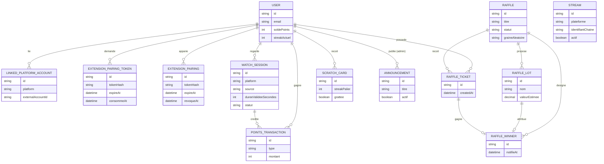

# 03. Modèle de données

Ce document décrit les entités principales. Le schéma Prisma définitif sera écrit par l'agent backend lors du passage en implémentation ; ce fichier fixe le contrat conceptuel à respecter. Le schéma réellement implémenté se trouve dans `backend/prisma/schema.prisma`.

## Diagramme entité-relation

## Entités principales

### User

- id, email, mot de passe (hash), pseudo, date de création
- streak_actuel, streak_max, derniere_visite_at
- solde_points

### LinkedPlatformAccount

- id, user_id, plateforme (twitch, youtube, facebook)
- identifiant externe, token OAuth chiffré, date de liaison

### ExtensionPairingToken (code d'appariement)

- id, user_id, token_hash (empreinte SHA-256 du code, jamais le code),
  expire_at, consomme_at, created_at
- Code à usage unique généré par `POST /extension/pairing-token` et saisi
  dans l'extension. Durée de vie courte (5 minutes) ; `consomme_at`
  matérialise l'usage unique, la consommation étant conditionnée à
  `consomme_at IS NULL` pour rester atomique face à deux échanges
  simultanés.

### ExtensionPairing (appareil apparié)

- id, user_id, token_hash (empreinte SHA-256 du jeton d'accès),
  expire_at, revoque_at, created_at
- Jeton opaque de longue durée (30 jours) que l'extension présente en
  `Authorization: Bearer`. Volontairement pas un JWT : `revoque_at`
  permet de couper l'accès d'un appareil immédiatement, ce qu'un jeton
  signé ne permettrait qu'à son expiration. Plafond de 5 appareils actifs
  par compte, les plus anciens étant révoqués au-delà.

### WatchSession

- id, user_id, plateforme, identifiant du stream
- debut_at, dernier_heartbeat_at, duree_validee_secondes
- statut (en_cours, terminee, invalidee)
- dernier_intervalle_secondes, intervalles_identiques_consecutifs :
  champs anti-fraude, utilisés pour détecter des heartbeats envoyés à un
  intervalle rigoureusement identique (signature d'un script), voir
  [05-security.md](05-security.md).

### Stream

- id, plateforme (twitch, youtube, facebook), identifiant de la chaîne,
  nom affiché, actif (booléen), created_at
- Catalogue des streams partenaires proposés sur le site, servi par
  `GET /streams`. En V1.0 il est renseigné manuellement (seed puis
  back-office administrateur) : la récupération automatique des lives via
  les API des plateformes suppose les intégrations OAuth, prévues plus
  tard. Le drapeau `actif` permet de retirer une chaîne de l'affichage
  sans supprimer son historique.

### PointsTransaction

- id, user_id, type (visite_quotidienne, watch_time, carte_a_gratter, ajustement_admin)
- montant, reference (par exemple watch_session_id), created_at

### Raffle (tirage au sort)

- id, titre, description, date_ouverture, date_tirage
- statut (ouvert, cloture, tire)
- graine_aleatoire, resultat_publie_at

### RaffleLot (lot)

- id, raffle_id, nom, valeur_estimee, quantite, fournisseur

### RaffleTicket

- id, raffle_id, user_id, created_at
- En V1.0, un ticket provient uniquement d'un gain de `ScratchCard` (pas de
  conversion directe de points, voir [01-features.md](01-features.md)).

### RaffleWinner

- id, raffle_id, lot_id, ticket_id, user_id, notifie_at

### ScratchCard (carte à gratter)

- id, user_id, streak_palier (palier de streak ayant débloqué la carte)
- grattee (booléen), gain_type, gain_montant, created_at, grattee_at

### Announcement

- id, titre, texte, actif (booléen), debut_at, fin_at, created_by (admin), created_at

## Contraintes clés à respecter

- Toute variation de `solde_points` doit passer par une `PointsTransaction`
  (source de vérité auditable, pas de mise à jour directe du solde).
- Une `WatchSession` ne peut créditer de points qu'après validation serveur
  des heartbeats (cf. [02-architecture.md](02-architecture.md)).
- En V1.0, un `RaffleTicket` n'est créé qu'à la suite du grattage réussi
  d'une `ScratchCard` (transaction atomique liant les deux). La conversion
  directe de points en ticket revient en V1.1 (voir
  [01-features.md](01-features.md)).
- Le tirage (`Raffle.graine_aleatoire` et algorithme) doit être journalisé
  pour permettre un audit indépendant, conformément à
  [10-legal-compliance.md](10-legal-compliance.md).
