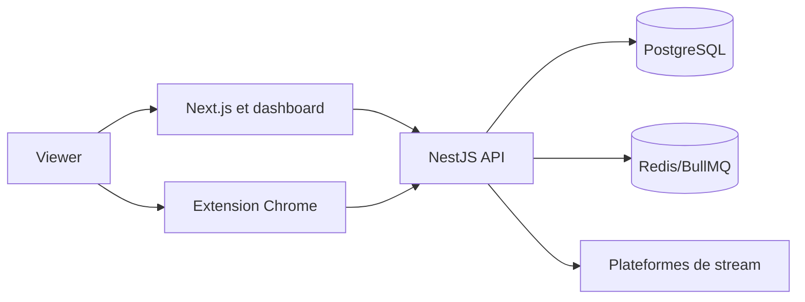

# Architecture technique

## Décisions et contraintes structurantes

TypeScript est utilisé partout. Next.js/React sert le frontend, NestJS l'API, Prisma/PostgreSQL les données, Redis/BullMQ les tâches et Docker Compose l'exécution. Cette baseline conserve les choix détectés dans le dépôt.

## Composants et responsabilités

| Composant | Responsabilité | Entrées | Sorties | Dépendances | Observabilité |
| --- | --- | --- | --- | --- | --- |
| Frontend Next.js | pages et dashboard | navigateur | appels API | backend | logs et erreurs |
| Backend NestJS | auth, points, admin | HTTP, WebSocket | JSON, événements | DB, Redis | logs et audit |
| Extension | observation de lecture | état autorisé | heartbeat | API, jeton | erreurs locales |
| PostgreSQL | source de vérité | commandes backend | données persistées | Prisma | métriques |

## Diagramme de contexte et conteneurs

Les heartbeats sont authentifiés et traités côté serveur. Les plateformes fournissent le contexte de stream, sans accès aux cookies ni à l'historique.

## Flux critiques et résilience

Les écritures de points sont idempotentes. Les tâches non critiques passent par BullMQ. Les timeouts et retries sont bornés ; un signal ambigu est ignoré et journalisé. Les opérations de tirage sont bloquées en cas d'erreur et restent rejouables uniquement avant publication.

## Qualité technique

La sécurité, l'accessibilité et les tests sont des critères de sortie. Les limites de performance et disponibilité seront mesurées sur l'environnement de validation avant production.

## Exploitation et dépendances externes

Le déploiement cible utilise Docker Compose sur Dokploy. Chaque service expose
un healthcheck adapté; une panne Redis ou d'une plateforme de stream ne doit pas
créditer de points et doit laisser une trace corrélable dans les logs. Les logs
applicatifs excluent les secrets, cookies et données de formulaire non
nécessaires. Les métriques minimales sont les erreurs HTTP, latence API,
heartbeats acceptés/rejetés, jobs en échec et disponibilité des dépendances.

Les dépendances externes sont PostgreSQL, Redis/BullMQ et les plateformes de
stream. Le backend applique des timeouts bornés, un nombre de retries limité et
un état dégradé explicite. Toute indisponibilité persistante déclenche une
alerte opérateur et interdit la validation de points incertaine. La procédure
de sauvegarde, restauration et rollback doit être exercée en préproduction
avant le passage en production.
---
last_updated: 2026-09-25
---
