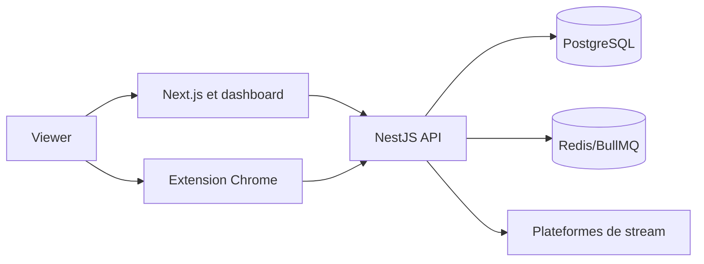

# Architecture technique

## Décisions et contraintes structurantes

TypeScript est utilisé partout. Next.js/React sert le frontend, NestJS l'API, Prisma/PostgreSQL les données, Redis/BullMQ les tâches et Docker Compose l'exécution. Cette baseline conserve les choix détectés dans le dépôt.

## Composants et responsabilités

| Composant | Responsabilité | Entrées | Sorties | Dépendances | Observabilité |
| --- | --- | --- | --- | --- | --- |
| Frontend Next.js | pages et dashboard | navigateur | appels API | backend | logs et erreurs |
| Backend NestJS | auth, points, admin | HTTP, WebSocket | JSON, événements | DB, Redis | logs et audit |
| Extension | observation de lecture | état autorisé | heartbeat | API, jeton | erreurs locales |
| PostgreSQL | source de vérité | commandes backend | données persistées | Prisma | métriques |

## Diagramme de contexte et conteneurs

Les heartbeats sont authentifiés et traités côté serveur. Les plateformes fournissent le contexte de stream, sans accès aux cookies ni à l'historique.

## Flux critiques et résilience

Les écritures de points sont idempotentes. Les tâches non critiques passent par BullMQ. Les timeouts et retries sont bornés ; un signal ambigu est ignoré et journalisé. Les opérations de tirage sont bloquées en cas d'erreur et restent rejouables uniquement avant publication.

## Qualité technique

La sécurité, l'accessibilité et les tests sont des critères de sortie. Les limites de performance et disponibilité seront mesurées sur l'environnement de validation avant production.

## Déploiement, exploitation et observabilité

- Le déploiement de production est décrit par `docker-compose.dokploy.yml`; Dokploy fournit le routage et TLS. PostgreSQL, Redis, backend, worker et frontend disposent de healthchecks ou de dépendances de démarrage documentées dans `docs/08-docker-infra.md`.
- `GET /health` est le point de contrôle applicatif du backend. Les erreurs backend sont journalisées côté serveur; les actions d'administration et le tirage disposent d'événements d'audit persistés.
- Redis sert aux files BullMQ et au relais d'événements temps réel. Le backend doit rester en instance unique tant que l'adaptateur Redis Socket.io n'est pas activé; cette contrainte est aussi documentée dans `docs/05-security.md`.
- Le rollback opérationnel consiste à redéployer le commit voulu depuis Dokploy, puis à vérifier les services `healthy`, la migration, les logs et une requête HTTPS. Aucun exercice de restauration de sauvegarde n'est encore prouvé.

Les objectifs SLO chiffrés, la rétention des logs, l'alerte et la stratégie de restauration restent des décisions DevOps ouvertes dans `docs/delivery/decision-log.md`; cette section ne les présente pas comme validés.
---
last_updated: 2026-10-03
---
