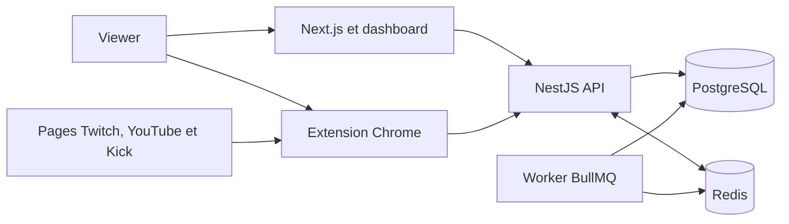

# Architecture technique

## Décisions et contraintes structurantes

TypeScript est utilisé dans le frontend, l'API et l'extension. Next.js/React sert le frontend, NestJS l'API, Prisma/PostgreSQL les données et Docker Compose l'exécution. Redis est utilisé par BullMQ pour les tirages planifiés et la maintenance, ainsi que pour le relais pub/sub Socket.io. Cette page complète [l'architecture courante](../02-architecture.md), qui décrit les responsabilités applicatives et le traitement des heartbeats.

## Composants et responsabilités

| Composant | Responsabilité | Entrées | Sorties | Dépendances | Signaux observés ou à prouver |
| --- | --- | --- | --- | --- | --- |
| Frontend Next.js | pages et dashboard | navigateur | appels API | backend | Erreurs visibles côté client; remontée centralisée non démontrée |
| Backend NestJS | auth, points, admin | HTTP, WebSocket | JSON, événements | DB, Redis | Logs applicatifs; collecte, conservation et alertes centralisées non démontrées |
| Extension | observation de lecture | état autorisé | heartbeat | API, jeton | Erreurs locales; télémétrie distante non démontrée |
| PostgreSQL | source de vérité | commandes backend | données persistées | Prisma | Healthcheck Compose; métriques non démontrées |
| Worker BullMQ | tirages planifiés et maintenance | jobs planifiés | écritures PostgreSQL et événements Redis | Prisma, Redis | Logs worker; collecte et alertes centralisées non démontrées |

## Diagramme de contexte et conteneurs

L'extension observe l'état autorisé de lecture dans la page ouverte par le viewer et envoie ses heartbeats authentifiés à l'API. L'API n'interroge pas les plateformes pour calculer les crédits; aucun accès aux cookies ni à l'historique de navigation n'est requis.
L'API utilise Redis pour le relais pub/sub Socket.io; le worker utilise Redis via BullMQ pour ses files planifiées.

## Flux critiques et résilience

Les heartbeats et crédits sont validés par `WatchSessionsService` et enregistrés dans une transaction PostgreSQL; voir le détail de la [mesure du watch time](../02-architecture.md#extension-navigateur-mesure-du-watch-time-décision-darchitecture-critique). BullMQ exécute les tirages planifiés et la maintenance périodique, pas l'agrégation des heartbeats. Les garanties d'idempotence, les reprises et les timeouts sont propres à chaque opération et doivent être vérifiés dans son implémentation; cette page ne pose pas de politique globale qui ne serait pas démontrée.

## Qualité technique

La sécurité, l'accessibilité et les tests sont des critères de sortie. Les limites de performance et disponibilité seront mesurées sur l'environnement de validation avant production.

## Exploitation et dépendances externes

La cible documentaire est Docker Compose sur Dokploy. Les fichiers Compose
suivis définissent des healthchecks pour les services persistants; ils ne
prouvent ni l'état courant du déploiement Dokploy ni la surveillance effective
de toutes les dépendances. Le Compose Dokploy contrôle l'API par `GET /`, tandis
que `GET /health` retourne actuellement un état statique `ok` et constitue une
liveness simple, sans contrôle de PostgreSQL ou Redis. Les timeouts et retries
présents sont propres à certains appels et jobs; ils ne constituent pas une
politique globale. Voir le relevé daté et les références dans
[`ops-audit-2026-10-18.md`](ops-audit-2026-10-18.md).

Les logs applicatifs doivent exclure secrets, cookies et données de formulaire
non nécessaires. Les métriques, une supervision corrélée, des seuils d'alerte,
un canal de notification et une astreinte constituent des capacités visées;
leur configuration et leur fonctionnement courant restent à démontrer. Les
événements de log du worker ne prouvent ni une collecte centralisée, ni une
règle active, ni la réception d'une notification. Toute panne Redis ou d'une
plateforme de stream ne doit pas créditer de points; cette règle métier doit
être confirmée par les contrôles fonctionnels appropriés.

La sauvegarde, la restauration et le rollback doivent être exercés sur une
préproduction autorisée avant toute prétention de readiness. Les contrôles
locaux datés du 7 et 8 octobre et l'observation de l'interface staging du
11 octobre 2026 ne prouvent pas l'état distant actuel. Aucune preuve actuelle
externe de rollback, sauvegarde ou restauration n'est établie par les éléments
documentaires cités. L'exercice opérateur et la décision de readiness restent
ouverts.
