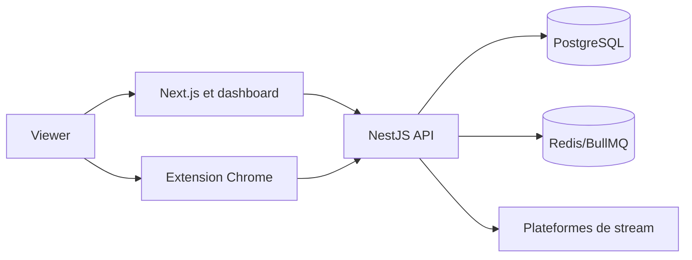

# Architecture technique

## Décisions et contraintes structurantes

TypeScript est utilisé partout. Next.js/React sert le frontend, NestJS l'API, Prisma/PostgreSQL les données, Redis/BullMQ les tâches et Docker Compose l'exécution. Cette baseline conserve les choix détectés dans le dépôt.

## Composants et responsabilités

| Composant | Responsabilité | Entrées | Sorties | Dépendances | Observabilité |
| --- | --- | --- | --- | --- | --- |
| Frontend Next.js | pages et dashboard | navigateur | appels API | backend | logs et erreurs |
| Backend NestJS | auth, points, admin | HTTP, WebSocket | JSON, événements | DB, Redis | logs et audit |
| Extension | observation de lecture | état autorisé | heartbeat | API, jeton | erreurs locales |
| PostgreSQL | source de vérité | commandes backend | données persistées | Prisma | métriques |

## Diagramme de contexte et conteneurs

Les heartbeats sont authentifiés et traités côté serveur. Les plateformes fournissent le contexte de stream, sans accès aux cookies ni à l'historique.

## Flux critiques et résilience

Les écritures de points sont idempotentes. Les tâches non critiques passent par BullMQ. Les timeouts et retries sont bornés ; un signal ambigu est ignoré et journalisé. Les opérations de tirage sont bloquées en cas d'erreur et restent rejouables uniquement avant publication.

## Qualité technique

La sécurité, l'accessibilité et les tests sont des critères de sortie. Les limites de performance et disponibilité seront mesurées sur l'environnement de validation avant production.

## Exploitation et dépendances externes

La cible documentaire est Docker Compose sur Dokploy. Les fichiers Compose
suivis définissent des healthchecks pour les services persistants; ils ne
prouvent ni l'état courant du déploiement Dokploy ni la surveillance effective
de toutes les dépendances. Le Compose Dokploy contrôle l'API par `GET /`, tandis
que `GET /health` retourne actuellement un état statique `ok` et constitue une
liveness simple, sans contrôle de PostgreSQL ou Redis. Les timeouts et retries
présents sont propres à certains appels et jobs; ils ne constituent pas une
politique globale. Voir le relevé daté et les références dans
[`ops-audit-2026-10-18.md`](ops-audit-2026-10-18.md).

Les logs applicatifs doivent exclure secrets, cookies et données de formulaire
non nécessaires. Les métriques, une supervision corrélée, des seuils d'alerte,
un canal de notification et une astreinte constituent des capacités visées;
leur configuration et leur fonctionnement courant restent à démontrer. Les
événements de log du worker ne prouvent ni une collecte centralisée, ni une
règle active, ni la réception d'une notification. Toute panne Redis ou d'une
plateforme de stream ne doit pas créditer de points; cette règle métier doit
être confirmée par les contrôles fonctionnels appropriés.

La sauvegarde, la restauration et le rollback doivent être exercés sur une
préproduction autorisée avant toute prétention de readiness. Les contrôles
locaux datés du 7 et 8 octobre et l'observation de l'interface staging du
11 octobre 2026 ne prouvent pas l'état distant actuel. Aucune preuve actuelle
externe de rollback, sauvegarde ou restauration n'est établie par les éléments
documentaires cités. L'exercice opérateur et la décision de readiness restent
ouverts.
