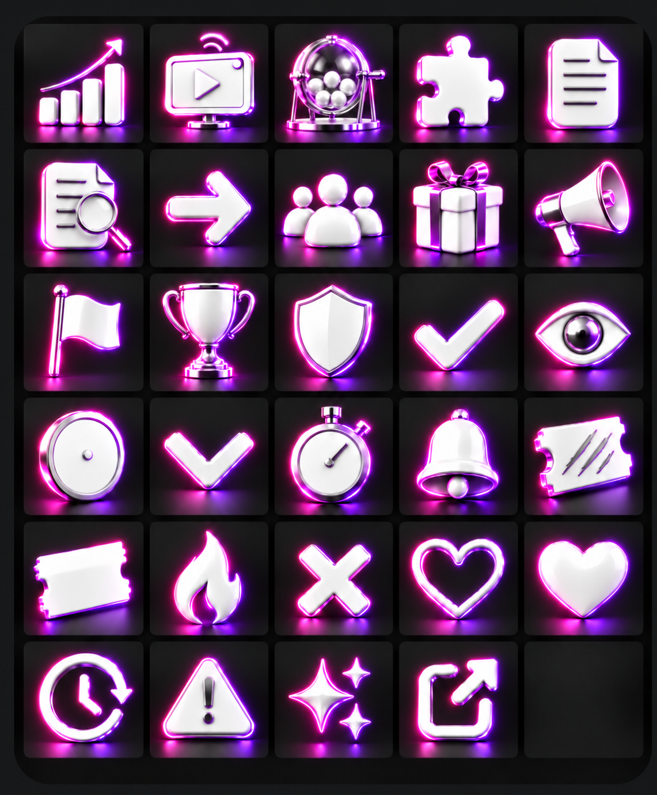

# Icônes Skkup: spécification propriétaire, audit et règles de contraste

## Source de référence et rendu accepté

La grille fournie par le propriétaire documente les formes de référence des
29 pictogrammes de `frontend/assets/icons/ui/`. Le premier rendu coloré,
accepté auparavant, est historique. Depuis le 2026-11-09, les 29 images runtime
sont recolorées en tons neutres blanc/argent, sans rose ni violet. Cette
recoloration conserve dimensions, alpha, silhouettes et détails, et ne modifie
pas les logos de marque/plateformes ni les illustrations séparées. Le S reste
intégré dans `points.png`; aucun calque de marque n'est ajouté. Les fonds et
bordures des composants restent ceux de l'interface et sont décrits séparément.

La planche reste la référence des formes. Le pack runtime courant contient
29 PNG RGBA transparents de 1254 × 1254 px, sous les mêmes chemins du registre.
Chaque pixel est achromatique (R=G=B) et l'alpha correspond octet pour octet
aux originaux. Le pack initial coloré est archivé dans
`../archive/design/ui-icons-before-neutral-2026-11-09.tar.gz`.

Exception propriétaire pour le glyphe `points`: la pièce `Monnaie_fond_transparent.png`
sert de base à l'image, avec le S conservé dans la pièce et aucun calque ajouté.
Le traitement de niveaux neutres ne change ni sa forme ni son alpha. Le fichier
runtime est `frontend/assets/icons/ui/points.png`, RGBA 1254 × 1254 px, SHA-256
`00b2ef947e70b77659f8c5282b5a384fe6e9d815e52735b740e23d20c28670cb`. Le
registre garde le nom stable `points`; `SkkupIcon` rend ce PNG comme une seule
image, sans composite.

## Recoloration neutre reproductible

`frontend/scripts/recolor-ui-icons-neutral.mjs` extrait les 29 fichiers depuis
le registre `SkkupIcon`, vérifie les sources RGBA 1254 × 1254 et calcule la
luminance Rec.709 avec les coefficients entiers 2126/7152/722. Le niveau obtenu
est projeté linéairement sur 64–255 puis écrit dans R, G et B; l’octet alpha
est copié sans modification. Le script écrit et vérifie les remplacements dans
un répertoire de sortie distinct, jamais dans `frontend/assets/icons/ui/`.
Le rendu passe donc du métal clair au blanc tout en gardant des ombres argentées.
Les originaux byte-identiques sont conservés hors du répertoire servi dans
`../archive/design/ui-icons-before-neutral-2026-11-09.tar.gz`.

## Audit navigateur Docker

L'audit a été réalisé sur l'instance Docker locale authentifiée, checkout
`test/ui-icon-001-docker-live`, HEAD
`3c856b062782092091c9f03b8505ba79193b61ae`. Les 26 routes App Router ont été
ouvertes pour relever les usages visibles et les états chargés. Deux captures
authentifiées sont conservées: `/dashboard` et `/admin`. Les dimensions DOM et
styles calculés ont été relevés sur ces deux routes; les autres routes sont
répertoriées avec leurs états et occurrences, mais leurs mesures calculées ne
sont pas disponibles dans cette passe. Les états de menus, notifications,
modales et certains contrôles conditionnels ne sont pas tous ouverts.

Fonds mesurés dans le navigateur:

| Emplacement rendu | Fond calculé | Bordure ou accent du composant observé |
|---|---|---|
| Shell admin | `rgb(6, 20, 45)` avec halo radial bleu nuit | Liserés bleus du shell |
| Overview viewer | Dégradé `rgba(25, 23, 74, .96)` vers `rgba(13, 30, 65, .96)` | Bordure cyan `rgba(98, 217, 255, .2)` |
| KPI viewer | `rgba(7, 24, 55, .45)` composé sur le panneau parent | Bordure bleue `rgba(75, 139, 219, .34)` |
| Carte à gratter viewer | Dégradé `rgba(10, 30, 67, .98)` vers `rgba(8, 22, 49, .98)` | Bordure bleue `rgba(42, 107, 183, .42)` |
| KPI admin | Dégradé `rgba(16, 36, 59, .98)` vers `rgba(9, 22, 39, .98)` | Pas de filtre CSS sur les PNG |
| Navigation sélectionnée | Tuile violet/fuchsia visible sur la capture; mesure computed par icône non conservée | Accent rose/violet |
| Vignettes de stream et images distantes | Média variable, non échantillonné par pixel pour chaque carte | Photo ou miniature variable |

Les ratios de contraste calculés dans le rapport QA concernent le texte blanc et
gris, pas les PNG multicolores. La visibilité ci-dessus est une revue visuelle,
pas un ratio WCAG attribué aux icônes. Les valeurs de fond et de bordure du
tableau décrivent l'interface mesurée; elles ne décrivent pas les couleurs des
PNG. Le code du registre rend une seule image pour chaque entrée et n'ajoute
pas de calque S.

Documents suivis sur les dimensions, usages et sources des médias: [assets dashboard V3](dashboard-v3-assets.md) et [inventaire des médias](media-inventory.md).

## QA responsive actuelle — 2026-10-26

Dans Docker avec une fixture authentifiée mockée, les contrôles responsive ont
réussi sur 29/29 vérifications aux largeurs 390, 767, 768 et 1280 px. Les
tests ciblés ont passé 105 tests; 6 tests ont été ignorés. Les captures
ci-dessous proviennent de cette fixture mockée et ne représentent pas une
session de production.

- Viewer à 390 px: [capture](ui-icon-style-qa-evidence/ui-icon-001-viewer-390.png).
- Admin à 390 px: [capture](ui-icon-style-qa-evidence/ui-icon-001-admin-390.png).
- Viewer à 1280 px: [capture](ui-icon-style-qa-evidence/ui-icon-001-viewer-1280.png).
- Admin à 1280 px: [capture](ui-icon-style-qa-evidence/ui-icon-001-admin-1280.png).

## Pack courant et usages du registre

Le pack runtime courant contient 29 PNG RGBA transparents de 1254 × 1254 px.
Le premier rendu blanc/argent à halos roses et violets, accepté auparavant,
est historique et archivé. Le pack courant est monochrome blanc/argent; chaque
pixel a des canaux R, G et B égaux et l'alpha reste identique aux originaux.
La planche propriétaire reste la référence des formes et des fonctions ci-dessous.

| Position | Nom du registre | Usages/pages constatés dans le code et les routes |
|---|---|---|
| R1C1 | `analytics` | Navigation viewer/admin, vue d'ensemble |
| R1C2 | `streams` | Navigation et `/streams`, `/dashboard/streams`, états vides; triangle Play blanc/argent |
| R1C3 | `draws` | Navigation, `/tirages`, `/dashboard/tirages`, cockpit admin |
| R1C4 | `extension` | Navigation et `/dashboard/extension`, jumelage |
| R1C5 | `rules` | Navigation et accès au règlement |
| R2C1 | `audit` | Navigation admin et `/admin/audit` |
| R2C2 | `arrow` | CTA, transitions et actions de navigation |
| R2C3 | `users` | Navigation et `/admin/users`, participations |
| R2C4 | `gift` | Navigation, lots, récompenses et états vides |
| R2C5 | `megaphone` | Navigation, annonces, cockpit admin |
| R3C1 | `flag` | Signalements du cockpit admin |
| R3C2 | `trophy` | Gagnant, résultat et participations aux tirages |
| R3C3 | `shield` | Sécurité, modération et navigation admin |
| R3C4 | `check` | Confirmation et état terminé |
| R3C5 | `eye` | Accès viewer et visionnage |
| R4C1 | `points` | Solde topbar, KPI points, transactions |
| R4C2 | `chevronDown` | Menu compte et sélecteurs |
| R4C3 | `timer` | Durée et échéance sur tirages |
| R4C4 | `bell` | Barre de navigation et notifications |
| R4C5 | `scratchCard` | Cartes à gratter et historique d'activité |
| R5C1 | `ticket` | Tickets de tirage, panneau KPI et résumé |
| R5C2 | `flame` | KPI « Série actuelle » du viewer et notification de série |
| R5C3 | `close` | Fermeture de dialogue et formulaire |
| R5C4 | `favoriteHeart` | Favori inactif dans les streams |
| R5C5 | `favoriteHeartActive` | Favori actif dans les streams |
| R6C1 | `statusPending` | État en attente/non validé |
| R6C2 | `warning` | Signalement/avertissement admin |
| R6C3 | `sparkle` | État vide ou accent décoratif |
| R6C4 | `arrowUpRight` | Lien externe dans la page tirages admin |
| R6C5 | — | Case réservée |
### Illustrations métier, hors grille des pictogrammes

Le registre contient aussi `extensionIllustration` et le `ticketIllustration`
réutilisé. `rewardIllustration` et son PNG dédié ont été retirés du runtime le
2026-11-03, car aucun composant ne les utilisait; l’interface récompenses garde
le pictogramme compact `scratchCard`. Le KPI « Série actuelle » utilise le
pictogramme `flame`; l'ancienne illustration de série a été retirée du
registre, de la route d'assets et du dépôt. Le PNG métier d'extension n'est pas
un glyphe de navigation et n'est pas régénéré par cette planche. Sa palette et
son contraste devront être examinés séparément si le propriétaire souhaite le
remplacer.
`ticketIllustration` pointe actuellement sur le même PNG que `ticket`; la
nouvelle proposition n'ajoute aucun calque S.

## Règles de lisibilité

Les tailles CSS doivent aussi être communiquées à `next/image` pour choisir
une source optimisée adaptée. Les KPI admin compacts utilisent 52 px sur
desktop et 48 px sous 768 px; leurs illustrations utilisent 52 px et 40 px.
Leurs appels `SkkupIcon` déclarent `width`/`height` à 52 et le `sizes`
responsive correspondant. Les libellés de navigation sont affichés à `.84rem`,
les icônes à `1.55rem` et la pièce points de la topbar à `1.25rem`; ces images
déclarent également leur `sizes`. Les tests ciblés couvrent les attributs et
les sources d'images.

- Conserver les fonds et accents CSS de l'interface tels que documentés; ils
  restent distincts des pixels des PNG.
- Sur une photo ou une vignette imprévisible, vérifier la lisibilité du PNG
  transparent dans son contexte et ajouter un support de contraste au
  composant si nécessaire.
- À 16–24 px, vérifier que la silhouette reste lisible; les reflets et ombres
  neutres ne doivent pas masquer les détails. Au-delà de 32 px, préserver les
  faces blanches et les biseaux argentés sans introduire de teinte rose ou violette.
- Ne pas ajouter de ressource S en calque ou composite sur une icône ou une
  illustration. L'emblème intégré à la source propriétaire de `points.png`
  est l'exception de fichier; le composant ne lui ajoute aucun calque.
- Les icônes décoratives ne remplacent pas le libellé accessible du bouton ou
  du lien. Conserver `aria-hidden` uniquement si le texte voisin donne déjà le
  sens; sinon fournir un nom accessible.

## Limites et état des preuves

La navigation Docker a couvert 26 routes, mais les styles calculés et les
dimensions image détaillées ne sont disponibles que sur `/dashboard` et
`/admin`. Les autres placements sont documentés à partir de la source et de
leur état rendu, sans prétendre à une mesure pixel par pixel. La copie des
assets suit la référence du propriétaire; elle ne remplace pas la QA finale
des états et tailles d'usage, ni les preuves de contraste dans chaque contexte.

**Statut : pack runtime recoloré en tons neutres le 2026-11-09.** La QA
responsive Docker et ses captures de fixture mockée ci-dessus portent sur le
pack coloré historique et ne prouvent pas le rendu du pack neutre ni celui
authentifié en production. Consulter la comparaison historique des assets
Docker/production dans
[dashboard-v3-assets.md](dashboard-v3-assets.md) pour les hashes d'images, qui
ne révèlent pas le SHA du build déployé.
