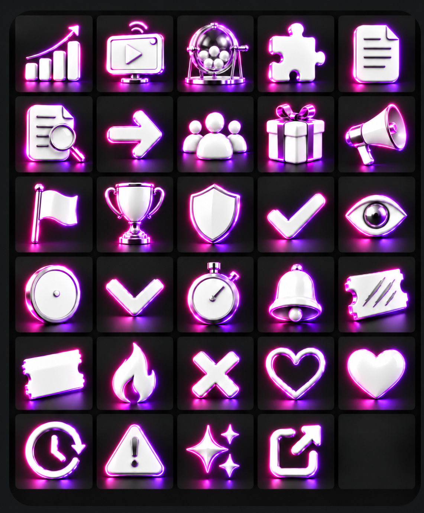

# Icônes Skkup: spécification propriétaire, audit et règles de contraste

## Source de référence et rendu accepté

La grille fournie par le propriétaire documente l'intention de départ pour les
29 pictogrammes de `asset/icons/ui/`; ses consignes de palette ne sont pas une
mesure des pixels du pack livré. Le propriétaire a explicitement accepté le
premier lot généré et demandé qu'aucune retouche de style ne soit faite. Le
rendu accepté comprend des objets à faces blanches, des biseaux argentés et des
halos de lumière diffus roses et violets. Ne pas décrire ces halos comme des
contours ou liserés colorés. Le composant n'ajoute aucune image de marque en
surimpression. `points.png` est l'exception de contenu: son emblème S est
intégré à l'image de monnaie fournie par le propriétaire. Les autres
pictogrammes ne reçoivent aucune marque superposée. Les fonds et bordures des
composants restent ceux de l'interface et sont décrits séparément ci-dessous.

La planche reste la référence de comparaison. Le pack runtime courant contient
29 PNG RGBA transparents de 1254 × 1254 px, sous les noms du registre. Le
propriétaire a confirmé l'acceptation de ce premier lot visuel. Le rendu retenu
présente des icônes blanches détaillées, des biseaux argentés et des halos
diffus rose/violet. Aucune nouvelle retouche de style n'est demandée.

Exception propriétaire pour le glyphe `points`: l'image de monnaie fournie
`Monnaie_fond_transparent.png`, avec son emblème S déjà intégré, a été choisie
et copiée sans retouche sous `asset/icons/ui/points.png`. Le fichier runtime
est RGBA 1254 × 1254 px, SHA-256
`24a670d71339bb3c98216fc55b4c710c65c7a33eff69b58f745470bd699e2886`. Le
registre garde le nom stable `points`; `SkkupIcon` rend ce PNG comme une seule
image et n'ajoute pas de calque ou de composite.

## Audit navigateur Docker

L'audit a été réalisé sur l'instance Docker locale authentifiée, checkout
`test/ui-icon-001-docker-live`, HEAD
`3c856b062782092091c9f03b8505ba79193b61ae`. Les 26 routes App Router ont été
ouvertes pour relever les usages visibles et les états chargés. Deux captures
authentifiées sont conservées: `/dashboard` et `/admin`. Les dimensions DOM et
styles calculés ont été relevés sur ces deux routes; les autres routes sont
répertoriées avec leurs états et occurrences, mais leurs mesures calculées ne
sont pas disponibles dans cette passe. Les états de menus, notifications,
modales et certains contrôles conditionnels ne sont pas tous ouverts.

Fonds mesurés dans le navigateur:

| Emplacement rendu | Fond calculé | Bordure ou accent du composant observé |
|---|---|---|
| Shell admin | `rgb(6, 20, 45)` avec halo radial bleu nuit | Liserés bleus du shell |
| Overview viewer | Dégradé `rgba(25, 23, 74, .96)` vers `rgba(13, 30, 65, .96)` | Bordure cyan `rgba(98, 217, 255, .2)` |
| KPI viewer | `rgba(7, 24, 55, .45)` composé sur le panneau parent | Bordure bleue `rgba(75, 139, 219, .34)` |
| Carte à gratter viewer | Dégradé `rgba(10, 30, 67, .98)` vers `rgba(8, 22, 49, .98)` | Bordure bleue `rgba(42, 107, 183, .42)` |
| KPI admin | Dégradé `rgba(16, 36, 59, .98)` vers `rgba(9, 22, 39, .98)` | Pas de filtre CSS sur les PNG |
| Navigation sélectionnée | Tuile violet/fuchsia visible sur la capture; mesure computed par icône non conservée | Accent rose/violet |
| Vignettes de stream et images distantes | Média variable, non échantillonné par pixel pour chaque carte | Photo ou miniature variable |

Les ratios de contraste calculés dans le rapport QA concernent le texte blanc et
gris, pas les PNG multicolores. La visibilité ci-dessus est une revue visuelle,
pas un ratio WCAG attribué aux icônes. Les valeurs de fond et de bordure du
tableau décrivent l'interface mesurée; elles ne décrivent pas les couleurs des
PNG. Le code du registre rend une seule image pour chaque entrée et n'ajoute
pas de calque S.

Documents suivis sur les dimensions, usages et sources des médias: [assets dashboard V3](dashboard-v3-assets.md) et [inventaire des médias](media-inventory.md).

Captures finales viewer et admin:

- Viewer: [320 px](ui-icon-style-qa-evidence/viewer-320-final-mock-auth.png), [768 px](ui-icon-style-qa-evidence/viewer-768-final-mock-auth.png), [1280 px](ui-icon-style-qa-evidence/viewer-1280-final-mock-auth.png).
- Admin: [320 px](ui-icon-style-qa-evidence/admin-320-final-mock-auth.png), [768 px](ui-icon-style-qa-evidence/admin-768-final-mock-auth.png), [1280 px](ui-icon-style-qa-evidence/admin-1280-final-mock-auth.png).

## Pack courant et usages du registre

Le pack runtime courant contient 29 PNG RGBA transparents de 1254 × 1254 px.
Le rendu visuel accepté par le propriétaire comprend des objets blancs, des
biseaux argentés et des halos de lumière diffus roses et violets. Cette
acceptation porte sur le premier lot généré; la planche demeure la référence
fournie par le propriétaire. Les détails source et les usages suivants
identifient les fonctions des pictogrammes, sans ajouter de prescription de
contour ou de liseré coloré.

| Position | Nom du registre | Usages/pages constatés dans le code et les routes |
|---|---|---|
| R1C1 | `analytics` | Navigation viewer/admin, vue d'ensemble |
| R1C2 | `streams` | Navigation et `/streams`, `/dashboard/streams`, états vides |
| R1C3 | `draws` | Navigation, `/tirages`, `/dashboard/tirages`, cockpit admin |
| R1C4 | `extension` | Navigation et `/dashboard/extension`, jumelage |
| R1C5 | `rules` | Navigation et accès au règlement |
| R2C1 | `audit` | Navigation admin et `/admin/audit` |
| R2C2 | `arrow` | CTA, transitions et actions de navigation |
| R2C3 | `users` | Navigation et `/admin/users`, participations |
| R2C4 | `gift` | Navigation, lots, récompenses et états vides |
| R2C5 | `megaphone` | Navigation, annonces, cockpit admin |
| R3C1 | `flag` | Signalements du cockpit admin |
| R3C2 | `trophy` | Gagnant, résultat et participations aux tirages |
| R3C3 | `shield` | Sécurité, modération et navigation admin |
| R3C4 | `check` | Confirmation et état terminé |
| R3C5 | `eye` | Accès viewer et visionnage |
| R4C1 | `points` | Solde topbar, KPI points, transactions |
| R4C2 | `chevronDown` | Menu compte et sélecteurs |
| R4C3 | `timer` | Durée et échéance sur tirages |
| R4C4 | `bell` | Barre de navigation et notifications |
| R4C5 | `scratchCard` | Cartes à gratter et historique d'activité |
| R5C1 | `ticket` | Tickets de tirage, panneau KPI et résumé |
| R5C2 | `flame` | Série/streak et notification |
| R5C3 | `close` | Fermeture de dialogue et formulaire |
| R5C4 | `favoriteHeart` | Favori inactif dans les streams |
| R5C5 | `favoriteHeartActive` | Favori actif dans les streams |
| R6C1 | `statusPending` | État en attente/non validé |
| R6C2 | `warning` | Signalement/avertissement admin |
| R6C3 | `sparkle` | État vide ou accent décoratif |
| R6C4 | `arrowUpRight` | Lien externe dans la page tirages admin |
| R6C5 | — | Case réservée |
### Illustrations métier, hors grille des pictogrammes

Le registre contient aussi `rewardIllustration`, `streakIllustration`,
`extensionIllustration` et le `ticketIllustration` réutilisé. Les trois PNG
métier reward, streak et extension ne sont pas des glyphes de navigation et
ne sont pas régénérés par cette planche. Leur palette et leur contraste devront
être examinés séparément si le propriétaire souhaite aussi les remplacer.
`ticketIllustration` pointe actuellement sur le même PNG que `ticket`; la
nouvelle proposition n'ajoute aucun calque S.

## Règles de lisibilité

Les tailles CSS doivent aussi être communiquées à `next/image` pour choisir
une source optimisée adaptée. Les KPI admin compacts utilisent 52 px sur
desktop et 48 px sous 768 px; leurs illustrations utilisent 52 px et 40 px.
Leurs appels `SkkupIcon` déclarent `width`/`height` à 52 et le `sizes`
responsive correspondant. Les icônes de navigation affichées à `1.55rem` et
la pièce points de la topbar affichée à `1.25rem` déclarent également leur
`sizes`. Les tests ciblés couvrent les attributs et les sources d'images.

- Conserver les fonds et accents CSS de l'interface tels que documentés; ils
  restent distincts des pixels des PNG.
- Sur une photo ou une vignette imprévisible, vérifier la lisibilité du PNG
  transparent dans son contexte et ajouter un support de contraste au
  composant si nécessaire.
- À 16–24 px, vérifier que la silhouette reste lisible; les halos lumineux
  diffus ne doivent pas masquer les détails. Au-delà de 32 px, préserver les
  faces blanches, les biseaux argentés et les halos roses/violets du lot accepté.
- Ne pas ajouter de ressource S en calque ou composite sur une icône ou une
  illustration. L'emblème intégré à la source propriétaire de `points.png`
  est l'exception de fichier; le composant ne lui ajoute aucun calque.
- Les icônes décoratives ne remplacent pas le libellé accessible du bouton ou
  du lien. Conserver `aria-hidden` uniquement si le texte voisin donne déjà le
  sens; sinon fournir un nom accessible.

## Limites et état des preuves

La navigation Docker a couvert 26 routes, mais les styles calculés et les
dimensions image détaillées ne sont disponibles que sur `/dashboard` et
`/admin`. Les autres placements sont documentés à partir de la source et de
leur état rendu, sans prétendre à une mesure pixel par pixel. La copie des
assets suit la référence du propriétaire; elle ne remplace pas la QA finale
des états et tailles d'usage, ni les preuves de contraste dans chaque contexte.

**Statut : la référence propriétaire et le premier lot runtime sont acceptés.**
La QA responsive et les preuves de rendu déployé restent distinctes; ce
document ne les approuve pas.
