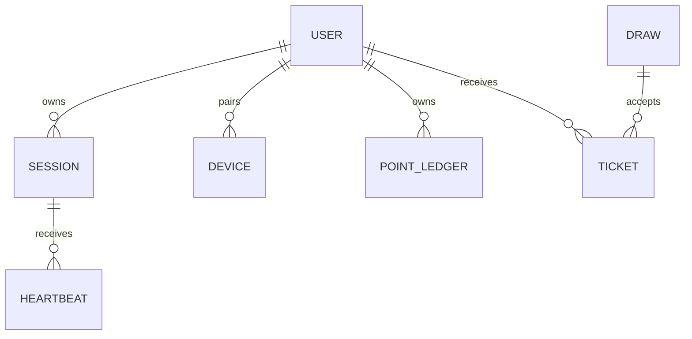

# Modèle de données

## Classification et cycle de vie

| Donnée ou entité | Sensibilité | Source | Usage | Rétention | Suppression | Responsable |
| --- | --- | --- | --- | --- | --- | --- |
| User, Session | personnelle | formulaire | compte et session | durée légale à définir | suppression/export | produit |
| Heartbeat, DeviceToken | comportementale | extension | validation activité | durée minimale nécessaire | purge documentée | backend |
| PointLedger, Ticket | activité | backend | solde et tirages | historique auditable | selon règlement | produit |
| FraudSignal, AuditLog | sensible | backend/admin | sécurité et traçabilité | durée à valider | accès restreint | sécurité |

## Entités, attributs et règles

| Entité | Attributs clés | Identifiant | Relations | Contraintes et invariants |
| --- | --- | --- | --- | --- |
| User | email, pseudo, hash | userId | sessions, appareils | email unique, hash jamais lisible |
| StreamSession | plateforme, début, fin | sessionId | heartbeats, ledger | durée serveur, pas de doublon |
| PointLedger | delta, source, clé idempotence | ledgerId | user, session | append-only |
| Draw | dates, statut, graine, empreinte | drawId | entries, prizes | figé avant tirage |
| Ticket | type, statut, user | ticketId | user, draw | jamais négatif |

## Diagramme de données

Les noms représentent les agrégats métier ; les attributs définitifs sont ceux du schéma Prisma.

## Décisions et preuves restantes

| Sujet | État | Responsable | Preuve requise |
|---|---|---|---|
| Durée de conservation User, Session, FraudSignal et AuditLog | ouverte, aucune durée légale n'est fixée dans le cahier | conformité | matrice de conservation validée et procédure d'export/suppression testée |
| Attributs définitifs et contraintes | à rapprocher du schéma Prisma courant avant approbation | backend | schéma Prisma relu, migration de validation et tests d'intégrité |
| Restauration et rollback | stratégie générale documentée, exercice non prouvé ici | DevOps | sauvegarde restaurée sur environnement de validation et rollback consigné |

## Migrations, intégrité et sauvegarde

Les migrations Prisma sont versionnées. Toute migration est testée sur une base de validation, sauvegardée avant production et accompagnée d'un plan de rollback documenté.
---
last_updated: 2026-09-25
---
