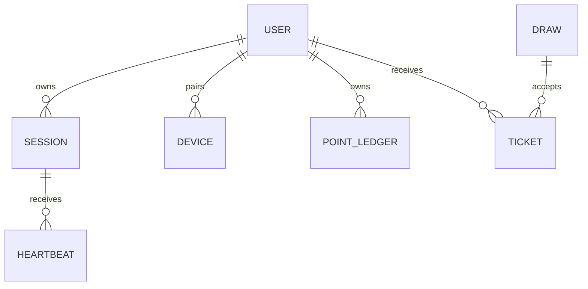

# Modèle de données

> **Document historique obsolète, supersédé et non normatif.** Ce modèle générique du 2026-09-25 ne décrit pas la source de vérité actuelle. Son tableau, ses délais, ses noms d'entités, ses exemples et ses procédures sont obsolètes et ne doivent pas être repris comme règles en vigueur, décisions approuvées ou preuve d'implémentation. Consulter le [modèle de données courant](../03-data-model.md) pour le schéma observé et les écarts, ainsi que les [décisions de readiness](../delivery/readiness-decision-request.md) pour les propositions encore à valider.

## Classification et cycle de vie

| Donnée ou entité | Sensibilité | Source | Usage | Rétention | Suppression | Responsable |
| --- | --- | --- | --- | --- | --- | --- |
| User, Session | personnelle | formulaire | compte et session | compte conservé pendant l'activité puis suppression trois ans après la dernière connexion, conformément à l'article 9 du règlement publié; durée des sessions techniques à préciser | demande d'accès, rectification, effacement, opposition et portabilité lorsque applicable via `skkup.pro@gmail.com`; procédure technique à compléter | produit et conformité |
| Heartbeat, DeviceToken | comportementale | extension | validation activité | durée minimale nécessaire | purge documentée | backend |
| PointLedger, Ticket | activité | backend | solde et tirages | historique auditable | selon règlement | produit |
| FraudSignal, AuditLog | sensible | backend/admin | sécurité et traçabilité | conservation limitée au besoin de sécurité et d'audit, durée exacte à confirmer par conformité avant production | accès restreint et purge contrôlée | sécurité et conformité |

## Entités, attributs et règles

| Entité | Attributs clés | Identifiant | Relations | Contraintes et invariants |
| --- | --- | --- | --- | --- |
| User | email, pseudo, hash | userId | sessions, appareils | email unique, hash jamais lisible |
| StreamSession | plateforme, début, fin | sessionId | heartbeats, ledger | durée serveur, pas de doublon |
| PointLedger | delta, source, clé idempotence | ledgerId | user, session | append-only |
| Draw | dates, statut, graine, empreinte | drawId | entries, prizes | figé avant tirage |
| Ticket | type, statut, user | ticketId | user, draw | jamais négatif |

## Diagramme de données

Les noms représentent les agrégats métier ; les attributs définitifs sont ceux du schéma Prisma.

## Migrations, intégrité et sauvegarde

Les migrations Prisma sont versionnées. Toute migration est testée sur une base de validation, sauvegardée avant production et accompagnée d'un plan de rollback documenté.

La durée de conservation du compte est déjà inscrite dans le règlement publié
à trois ans après la dernière connexion. Cette valeur doit encore être
confirmée par conformité et reliée à une purge testée avant production. Les
autres catégories restent à préciser; elles ne sont pas déduites du schéma
technique. La procédure technique d'export/suppression reste à compléter.
