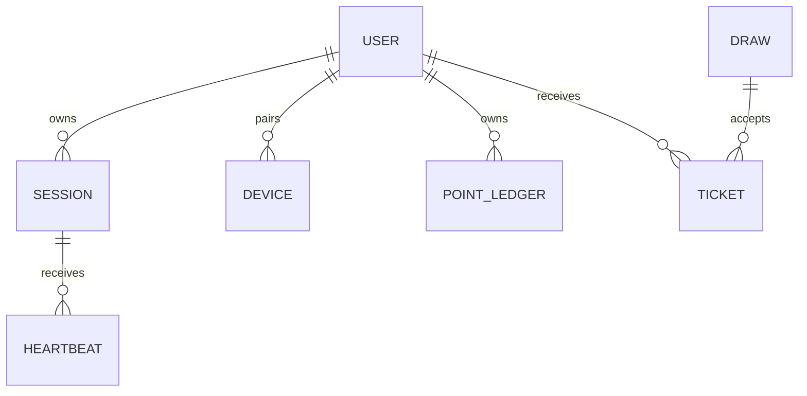

# Modèle de données

## Classification et cycle de vie

| Donnée ou entité | Sensibilité | Source | Usage | Rétention | Suppression | Responsable |
| --- | --- | --- | --- | --- | --- | --- |
| User, OAuthState | personnelle / authentification | formulaire et OAuth | compte, session et retours OAuth | durée légale à définir; OAuthState expiré à purger | suppression/export; nonce consommé ou expiré | produit / backend |
| WatchSession, ExtensionPairing, ExtensionPairingToken | comportementale / credential | extension et lecteur | validation d'activité et appariement | durée minimale nécessaire; expirations explicites | révocation et purge documentée | backend |
| PointsTransaction, RaffleTicket, RaffleWinner | activité | backend | solde, participation et résultat | historique auditable | selon règlement | produit |
| FraudFlag, RaffleDrawAudit, ContentAuditEvent | sensible | backend/admin | sécurité, tirage et traçabilité | durée à valider | accès restreint | sécurité |

## Entités, attributs et règles

| Entité | Attributs clés | Identifiant | Relations | Contraintes et invariants |
| --- | --- | --- | --- | --- |
| User | `email`, `passwordHash`, `pseudo`, `role`, streak, solde | `id` CUID | appariements, sessions, transactions, tirages | email unique; hash jamais renvoyé; rôle par défaut `VIEWER` |
| WatchSession | `platform`, `streamExternalId`, `source`, timestamps, durée validée, statut | `id` CUID | user, transactions, signaux fraude | durée calculée serveur; index statut/heartbeat; statut enum |
| ExtensionPairing | hash de jeton, expiration, révocation | `id` CUID | user | hash unique; révocation immédiate possible |
| PointsTransaction | type, montant, session optionnelle, date | `id` CUID | user, session | type enum; montant écrit par le backend |
| Raffle | titre, dates, statut, graine, date de publication | `id` CUID | lots, tickets, gagnants, audits | statut enum; tirage audité et publication contrôlée |
| RaffleTicket | user, raffle, date de création | `id` CUID | user, tirage, gagnant éventuel | relations avec suppression en cascade selon schéma |

## Diagramme de données

Les noms représentent les agrégats métier ; les attributs définitifs sont ceux du schéma Prisma.

## Décisions et preuves restantes

| Sujet | État | Responsable | Preuve requise |
|---|---|---|---|
| Durée de conservation User, Session, FraudSignal et AuditLog | ouverte, aucune durée légale n'est fixée dans le cahier | conformité | matrice de conservation validée et procédure d'export/suppression testée |
| Attributs définitifs et contraintes | rapprochement initial effectué avec `backend/prisma/schema.prisma`; couverture exhaustive et migration de validation restent à produire | backend | revue du schéma, migration de validation et tests d'intégrité |
| Restauration et rollback | stratégie générale documentée, exercice non prouvé ici | DevOps | sauvegarde restaurée sur environnement de validation et rollback consigné |

## Migrations, intégrité et sauvegarde

Les migrations Prisma sont versionnées. Toute migration est testée sur une base de validation, sauvegardée avant production et accompagnée d'un plan de rollback documenté.
---
last_updated: 2026-10-03
---
