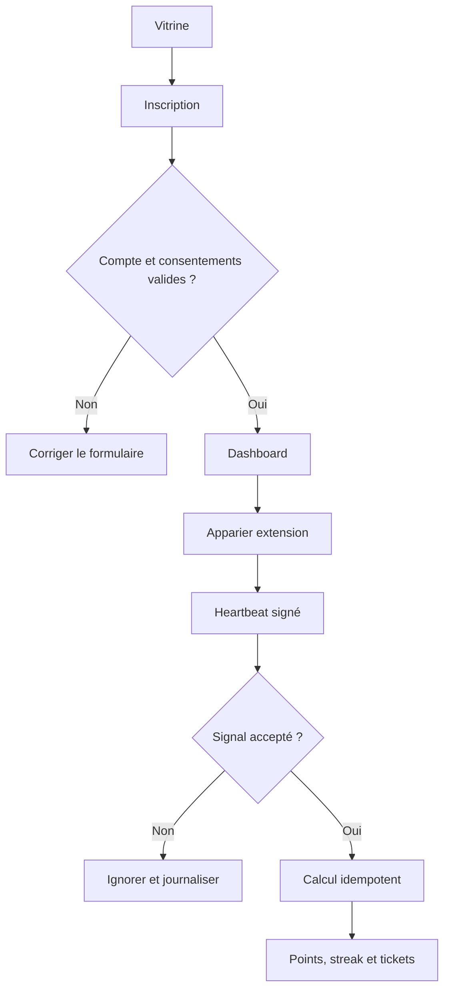
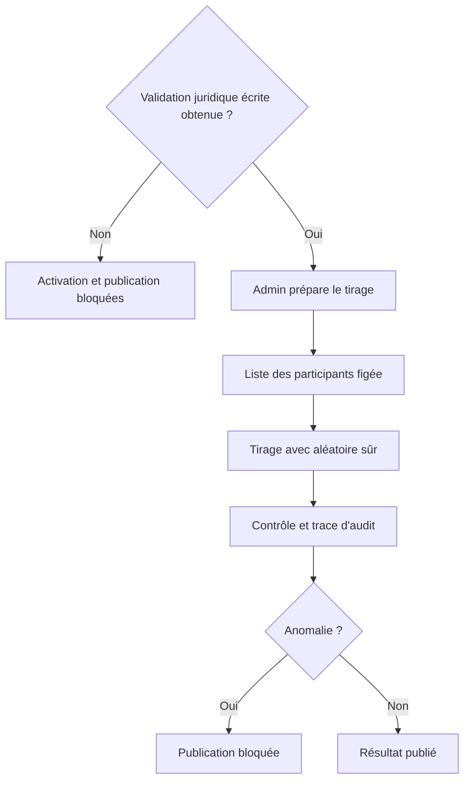
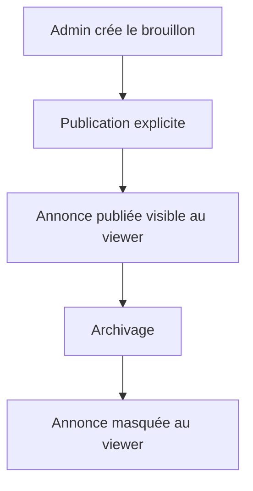
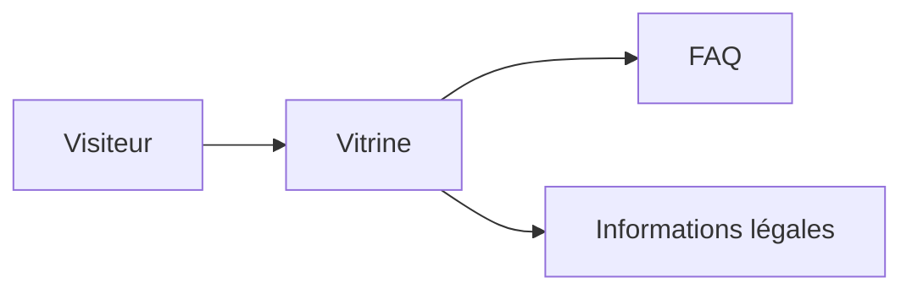
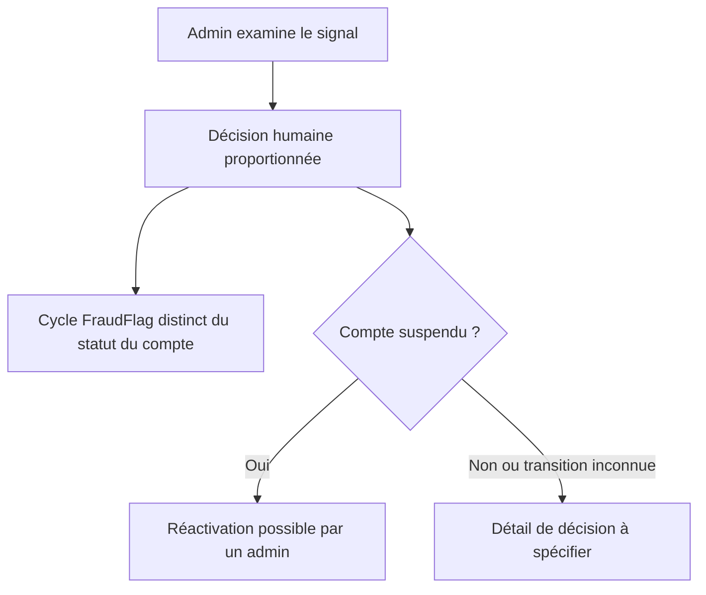

# Parcours utilisateur

## Inventaire des parcours

| ID | Déclencheur | Acteur | Résultat attendu | Échecs et reprises | Stories liées |
| --- | --- | --- | --- | --- | --- |
| FLOW-001 | inscription puis visionnage | viewer | points visibles dans dashboard | session, stream ou heartbeat invalide ; reprise par reconnexion | US-002 à US-005 |
| FLOW-002 | préparer un tirage | admin | préparation interne auditable; publication publique uniquement après validation juridique écrite | sans validation écrite, tirage/publication désactivé; anomalie bloque la publication | US-006 |
| FLOW-003 | créer puis gérer une annonce | admin, puis viewer | annonce publiée explicitement visible aux viewers; brouillon et archive exclus | transition invalide sans mutation; aucun passage implicite en publication | US-008 |
| FLOW-004 | consulter ses récompenses garanties et les opérations disponibles | viewer | boutique limitée aux récompenses garanties; participation aléatoire indisponible publiquement avant validation juridique écrite | tirages et cartes à gratter désactivés publiquement avant validation; aucune chance vendue; règles complètes dans la [baseline readiness](../delivery/readiness-decision-request.md) | US-009 |
| FLOW-005 | gérer les lots et le contenu éditorial | admin habilité | Lot de hasard : brouillon jusqu'à validation juridique écrite, puis publication explicite, clôture, résultat audité et archivage; contenu : brouillon, publication explicite et archivage | lot de hasard non visible publiquement avant validation; champs requis, instantané des conditions et historique des transitions; règles dans la [baseline readiness](../delivery/readiness-decision-request.md) | US-010 |
| FLOW-006 | notifier un gagnant et traiter sa demande de support | gagnant, support | notification privée sous sept jours après validation journalisée; réponse sous quatorze jours après réception | réclamation privée; aucun pseudo publié par défaut; pseudo publié seulement sur choix facultatif, distinct | US-011 |
| FLOW-007 | consulter le service public, la FAQ et les informations légales | visiteur | vitrine, FAQ et légal accessibles | revue complète de navigation, contenu et provenance des médias à produire | US-001 |
| FLOW-008 | examiner un signalement de fraude et gérer une éventuelle suspension | admin | décision humaine proportionnée; un compte suspendu peut être réactivé par un admin; statut `FraudFlag` distinct | permissions, transitions, mutation persistée, audit et reprise restent `needs-review` | US-007 |

## Diagramme des parcours critiques

Le diagramme ci-dessus couvre l'inscription, l'appariement et le crédit serveur. Le tirage manuel suit une procédure séparée documentée dans le règlement et le back-office. La baseline produit des FLOW-004 à FLOW-006 est consignée dans la [demande de readiness](../delivery/readiness-decision-request.md); leur statut reste `needs-review` jusqu'aux validations spécialisées et preuves requises.

## Détails par parcours

### FLOW-001

- Préconditions : visiteur éligible, email disponible et documents applicables présentés.
- Étapes nominales : inscription, consentement, connexion, appariement, visionnage, heartbeats, calcul serveur.
- Validations et erreurs : âge cible, session, jeton, cadence, plateforme compatible et plafond quotidien.
- Annulation, reprise et persistance : déconnexion ou heartbeat invalide sans crédit ; reprise depuis l'état serveur.
- Critères de sortie : dashboard mis à jour avec ledger et historique cohérents.

### FLOW-002 — tirage manuel auditable

- Règles de travail : après validation juridique écrite du mécanisme et du
  règlement, tirage lancé manuellement par l'admin; liste figée, aléatoire sûr,
  audit et publication uniquement après contrôle (US-006). Avant cette
  validation, seules la préparation interne et la spécification sont permises.
- État : preuve de la source d'entropie, des permissions, de l'immutabilité,
  de la persistance et du parcours intégré reste `needs-review`.

### FLOW-003

- Préconditions : admin autorisé; la spécification cible du cycle est relue.
- Étapes nominales : l'admin crée une annonce en `DRAFT`, peut la modifier en
  brouillon, la publie par une action explicite (`PUBLISHED`), puis peut
  l'archiver (`ARCHIVED`). Le viewer ne reçoit que les annonces publiées.
- Validations et erreurs : la création ne publie jamais implicitement; une
  transition invalide ne modifie pas l'annonce. Les règles détaillées de
  publication, archivage et restauration sont définies dans la
  [conception du cycle](../design/announcement-lifecycle-2026-10-22.md).
- Annulation, reprise et persistance : l'archivage masque l'annonce sans la
  supprimer; une restauration suit l'état antérieur conformément à la
  spécification cible.
- Critères de sortie : `DRAFT` et `ARCHIVED` sont exclus de la liste viewer;
  `PUBLISHED` y est inclus. Ces critères décrivent la cible et ne prouvent pas
  l'implémentation.

### FLOW-004 — tickets et participation

- Périmètre accepté : consulter les récompenses et les opérations disponibles.
- Baseline prudente mandatée : boutique limitée aux récompenses garanties,
  achetées avec des points non achetables/non transférables. Aucun ticket,
  tirage au sort ou jeu à gratter n'est activé publiquement avant validation
  juridique écrite du mécanisme et du règlement.
- Une participation gratuite unique par compte et opération, sans dépense,
  achat, abonnement payant ou visionnage obligatoire, reste une option
  conditionnelle à cette validation. Les cartes à gratter de hasard restent
  désactivées dans l'intervalle. Les détails sont dans la [baseline
  readiness](../delivery/readiness-decision-request.md).
- État : `needs-review` jusqu'à la validation juridique, la revue
  Data/Conformité, la spécification et les preuves d'implémentation. Le tirage
  manuel admin documenté par FLOW-002 n'autorise pas à lui seul une activation
  publique.

### FLOW-005 — lots et contenus éditoriaux

- Périmètre accepté : l'admin gère les lots et les contenus éditoriaux.
- Baseline mandatée : le lot attribué par hasard reste en `DRAFT` non visible
  publiquement jusqu'à validation juridique écrite, puis suit `DRAFT` →
  `PUBLISHED` → `CLOSED` → `DRAWN` →
  `ARCHIVED`; le contenu éditorial suit séparément `DRAFT` → publication
  explicite → `ARCHIVED`. Champs requis, instantané des règles publiées et audit
  des transitions sont définis dans la [baseline readiness](../delivery/readiness-decision-request.md).
- État : règles de travail documentées; `needs-review` demeure pour les
  contrats, permissions, provenance des médias, implémentation et preuves QA.

### FLOW-006 — gagnant et support

- Exigences acceptées : notification au gagnant sous sept jours, support par
  email et réponse sous quatorze jours. Le cahier emploie historiquement
  « pseudo anonymisé »; la baseline mandatée remplace cette formulation, car un
  pseudo ré-identifiable reste une donnée personnelle.
- Baseline mandatée : notification privée sous sept jours à compter de la
  validation journalisée du tirage; réclamation traitée en privé; pas de
  publication d'identifiant par défaut. Publication facultative du pseudo
  seulement après un choix distinct, facultatif et révocable. Prospection
  facultative, séparée du tirage.
- État : règles de travail documentées; `needs-review` demeure pour la revue
  Data/Conformité, l'intégration du canal transactionnel et les preuves QA.

### FLOW-007 — visite publique

- Critères acceptés : vitrine, FAQ et informations légales accessibles au
  visiteur, conformément à US-001.
- État : les critères sont documentés; la relecture complète des routes, du
  contenu publié, de l'accessibilité et de la provenance des médias reste
  `needs-review`.

### FLOW-008 — examen d'un signal de fraude

- Règle confirmée par le propriétaire : décision humaine et proportionnée; si
  le compte est suspendu, un admin peut le réactiver; `FraudFlag` suit son
  cycle distinct.
- État : permissions, transitions exactes, audit persistant et preuve du
  parcours intégré restent `needs-review`. Le diagramme ne spécifie pas les
  règles absentes.
