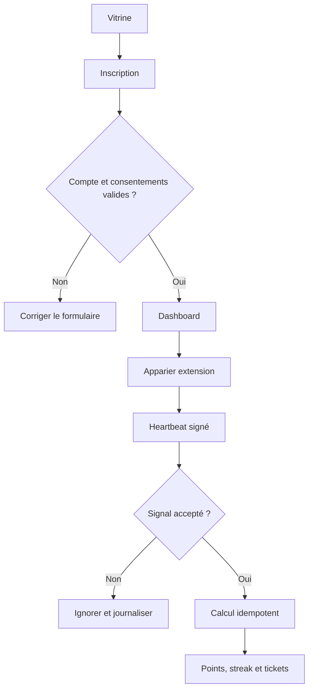
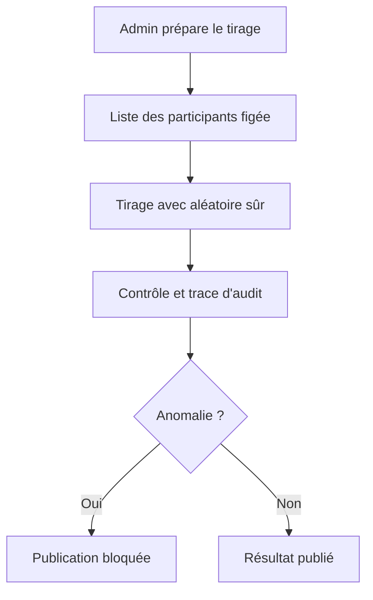
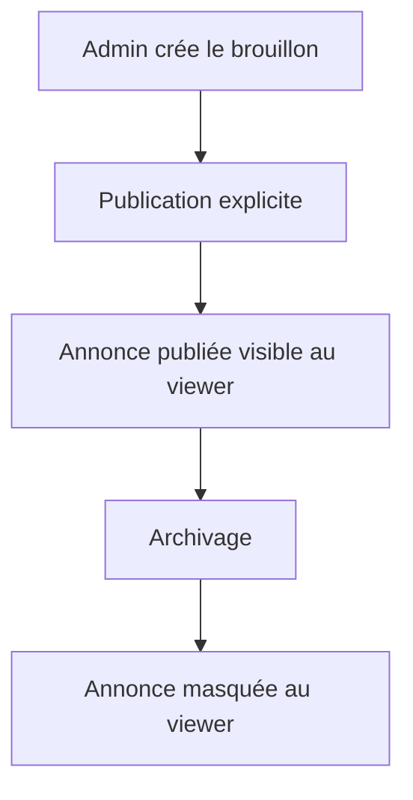
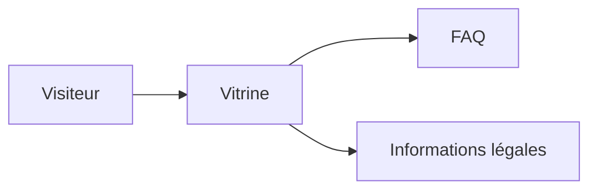
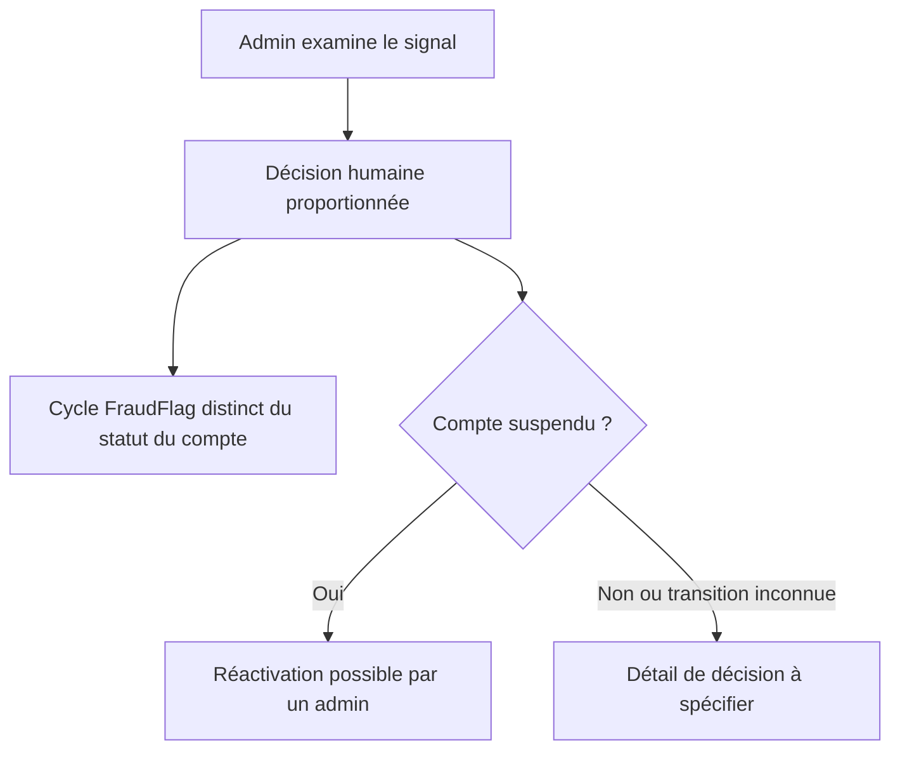

# Parcours utilisateur

## Inventaire des parcours

| ID | Déclencheur | Acteur | Résultat attendu | Échecs et reprises | Stories liées |
| --- | --- | --- | --- | --- | --- |
| FLOW-001 | inscription puis visionnage | viewer | points visibles dans dashboard | session, stream ou heartbeat invalide ; reprise par reconnexion | US-002 à US-005 |
| FLOW-002 | organisation d'un tirage | admin | résultat publié et auditable | anomalie bloque la publication | US-006 |
| FLOW-003 | créer puis gérer une annonce | admin, puis viewer | annonce publiée explicitement visible aux viewers; brouillon et archive exclus | transition invalide sans mutation; aucun passage implicite en publication | US-008 |
| FLOW-004 | consulter ses tickets et participer à un tirage disponible | viewer | participation enregistrée selon les règles produit validées | obtention, coût, éligibilité, consommation et limites restent à définir; aucun résultat métier n'est inféré | US-009 |
| FLOW-005 | gérer les lots et le contenu éditorial | admin | éléments gérés selon les règles produit à définir | champs, transitions, validation et publication restent à spécifier | US-010 |
| FLOW-006 | notifier un gagnant et traiter sa demande de support | gagnant, support | gagnant notifié sous sept jours, réponse sous quatorze jours, pseudo anonymisé | déclencheur et procédure de réclamation restent à définir | US-011 |
| FLOW-007 | consulter le service public, la FAQ et les informations légales | visiteur | vitrine, FAQ et légal accessibles | revue complète de navigation, contenu et provenance des médias à produire | US-001 |
| FLOW-008 | examiner un signalement de fraude et gérer une éventuelle suspension | admin | décision humaine proportionnée; un compte suspendu peut être réactivé par un admin; statut `FraudFlag` distinct | permissions, transitions, mutation persistée, audit et reprise restent `needs-review` | US-007 |

## Diagramme des parcours critiques

Le diagramme ci-dessus couvre l'inscription, l'appariement et le crédit serveur. Le tirage manuel suit une procédure séparée documentée dans le règlement et le back-office. FLOW-004 à FLOW-006 sont maintenant inventoriés, mais leurs étapes détaillées restent `needs-review` tant que les règles indiquées dans le tableau ne sont pas décidées; cette limite évite d'inventer le métier.

## Détails par parcours

### FLOW-001

- Préconditions : visiteur éligible, email disponible et documents applicables présentés.
- Étapes nominales : inscription, consentement, connexion, appariement, visionnage, heartbeats, calcul serveur.
- Validations et erreurs : âge cible, session, jeton, cadence, plateforme compatible et plafond quotidien.
- Annulation, reprise et persistance : déconnexion ou heartbeat invalide sans crédit ; reprise depuis l'état serveur.
- Critères de sortie : dashboard mis à jour avec ledger et historique cohérents.

### FLOW-002 — tirage manuel auditable

- Règles acceptées : tirage lancé manuellement par l'admin; liste figée,
  aléatoire sûr, audit et publication uniquement après contrôle (US-006).
- État : preuve de la source d'entropie, des permissions, de l'immutabilité,
  de la persistance et du parcours intégré reste `needs-review`.

### FLOW-003

- Préconditions : admin autorisé; la spécification cible du cycle est relue.
- Étapes nominales : l'admin crée une annonce en `DRAFT`, peut la modifier en
  brouillon, la publie par une action explicite (`PUBLISHED`), puis peut
  l'archiver (`ARCHIVED`). Le viewer ne reçoit que les annonces publiées.
- Validations et erreurs : la création ne publie jamais implicitement; une
  transition invalide ne modifie pas l'annonce. Les règles détaillées de
  publication, archivage et restauration sont définies dans la
  [conception du cycle](../design/announcement-lifecycle-2026-10-22.md).
- Annulation, reprise et persistance : l'archivage masque l'annonce sans la
  supprimer; une restauration suit l'état antérieur conformément à la
  spécification cible.
- Critères de sortie : `DRAFT` et `ARCHIVED` sont exclus de la liste viewer;
  `PUBLISHED` y est inclus. Ces critères décrivent la cible et ne prouvent pas
  l'implémentation.

### FLOW-004 — tickets et participation

- Périmètre accepté : consulter les tickets et participer aux tirages.
- Décisions bloquantes : comment les tickets sont obtenus et consommés, quelles
  sont les conditions d'éligibilité et les limites de participation.
- État : `needs-review`; ne pas définir de parcours nominal ou d'erreur métier
  avant la décision owner. Le tirage manuel admin reste le FLOW-002.

### FLOW-005 — lots et contenus éditoriaux

- Périmètre accepté : l'admin gère les lots et les contenus éditoriaux.
- Décisions bloquantes : champs, états, transitions, approbation et publication
  propres à chaque catégorie.
- État : `needs-review`; aucune transition de workflow n'est supposée.

### FLOW-006 — gagnant et support

- Exigences acceptées : notification au gagnant sous sept jours, support par
  email, réponse sous quatorze jours et pseudo anonymisé.
- Décisions bloquantes : événement qui déclenche la notification, contenu du
  message et procédure de réclamation.
- État : `needs-review` pour le déroulé détaillé. Les délais et l'anonymisation
  restent des critères issus du cahier accepté.

### FLOW-007 — visite publique

- Critères acceptés : vitrine, FAQ et informations légales accessibles au
  visiteur, conformément à US-001.
- État : les critères sont documentés; la relecture complète des routes, du
  contenu publié, de l'accessibilité et de la provenance des médias reste
  `needs-review`.

### FLOW-008 — examen d'un signal de fraude

- Règle confirmée par le propriétaire : décision humaine et proportionnée; si
  le compte est suspendu, un admin peut le réactiver; `FraudFlag` suit son
  cycle distinct.
- État : permissions, transitions exactes, audit persistant et preuve du
  parcours intégré restent `needs-review`. Le diagramme ne spécifie pas les
  règles absentes.
