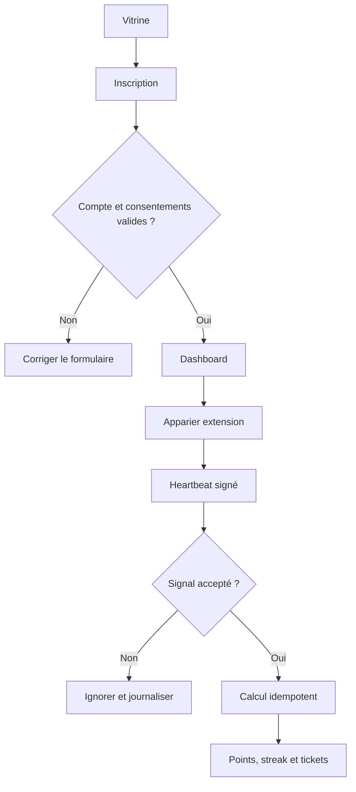

# Parcours utilisateur

## Inventaire des parcours

| ID | Déclencheur | Acteur | Résultat attendu | Échecs et reprises | Stories liées |
| --- | --- | --- | --- | --- | --- |
| FLOW-001 | inscription puis visionnage | viewer | points visibles dans dashboard | session, stream ou heartbeat invalide ; reprise par reconnexion | US-002 à US-005 |
| FLOW-002 | organisation d'un tirage | admin | résultat publié et auditable | anomalie bloque la publication | US-006 |
| FLOW-003 | signal fraude à examiner | admin | décision tracée et réversible | rôle insuffisant, signal introuvable ou action invalide ; réexamen manuel | US-007 |
| FLOW-004 | révocation et reprise de session | viewer/admin | session ou appareil invalidé sans fuite de données | cookie expiré, mot de passe changé, appareil révoqué ou backend indisponible ; reconnexion et état serveur comme source | US-002, US-003, US-007 |

## Diagramme des parcours critiques

Le parcours couvre l'inscription, l'appariement et le crédit serveur. Le tirage manuel suit une procédure séparée documentée dans le règlement et le back-office.

Le parcours admin couvre aussi l'examen humain des signaux de fraude et le tirage. Une révocation ne supprime pas silencieusement l'historique auditable : elle invalide le credential ou la session, affiche une erreur explicite et permet une reconnexion contrôlée.

## Détails par parcours

### FLOW-001

- Préconditions : visiteur éligible, email disponible et documents applicables présentés.
- Étapes nominales : inscription, consentement, connexion, appariement, visionnage, heartbeats, calcul serveur.
- Validations et erreurs : âge cible, session, jeton, cadence, plateforme compatible et plafond quotidien.
- Annulation, reprise et persistance : déconnexion ou heartbeat invalide sans crédit ; reprise depuis l'état serveur.
- Critères de sortie : dashboard mis à jour avec ledger et historique cohérents.

### FLOW-002

- Préconditions : admin authentifié, tirage ouvert et tickets éligibles disponibles.
- Étapes nominales : vérifier la liste, déclencher le tirage, persister l'audit, contrôler le résultat puis publier.
- Validations et erreurs : rôle insuffisant, tirage déjà tiré, liste vide ou erreur de persistance bloquent la publication et sont journalisés.
- Reprise : reprendre avant publication uniquement si l'état serveur le permet; ne jamais recalculer silencieusement un résultat publié.
- Critères de sortie : résultat public, empreinte et audit consultables.

### FLOW-003

- Préconditions : admin authentifié et signal ouvert visible dans le back-office.
- Étapes nominales : examiner le signal, consulter le contexte, choisir examiner/ignorer ou suspendre selon les règles, enregistrer l'acteur et la justification.
- Validations et erreurs : un viewer reçoit 403; un signal absent ou déjà traité reçoit une erreur explicite; l'automatisation ne constitue pas seule la décision significative.
- Reprise : une décision peut être réexaminée par un admin habilité selon la procédure de support; l'événement d'audit reste conservé.
- Critères de sortie : statut du signal cohérent, justification tracée et accès aux données limité.

### FLOW-004

- Préconditions : session web ou appareil apparié existant.
- Étapes nominales : demander la déconnexion, changer le mot de passe ou révoquer l'appareil; invalider le credential; reconnecter si nécessaire.
- Validations et erreurs : cookie expiré, token révoqué ou API indisponible ne doivent pas créditer de points; l'interface propose une reconnexion ou un retry borné.
- Critères de sortie : aucune nouvelle opération protégée n'est acceptée avec le credential révoqué; l'état persistant reste cohérent.
---
last_updated: 2026-10-03
---
