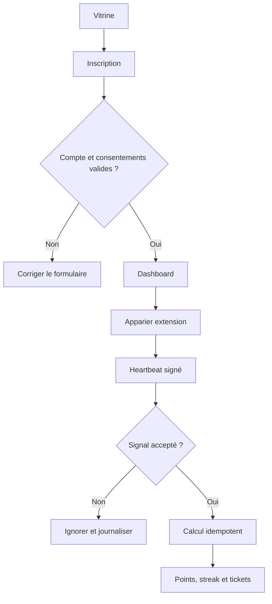

# Parcours utilisateur

## Inventaire des parcours

| ID | Déclencheur | Acteur | Résultat attendu | Échecs et reprises | Stories liées |
| --- | --- | --- | --- | --- | --- |
| FLOW-001 | inscription puis visionnage | viewer | points visibles dans dashboard | session, stream ou heartbeat invalide ; reprise par reconnexion | US-002 à US-005 |
| FLOW-002 | organisation d'un tirage | admin | résultat publié et auditable | anomalie bloque la publication | US-006 |

## Diagramme des parcours critiques

Le parcours couvre l'inscription, l'appariement et le crédit serveur. Le tirage manuel suit une procédure séparée documentée dans le règlement et le back-office.

## Détails par parcours

### FLOW-001

- Préconditions : visiteur éligible, email disponible et documents applicables présentés.
- Étapes nominales : inscription, consentement, connexion, appariement, visionnage, heartbeats, calcul serveur.
- Validations et erreurs : âge cible, session, jeton, cadence, plateforme compatible et plafond quotidien.
- Annulation, reprise et persistance : déconnexion ou heartbeat invalide sans crédit ; reprise depuis l'état serveur.
- Critères de sortie : dashboard mis à jour avec ledger et historique cohérents.
---
last_updated: 2026-09-25
---
